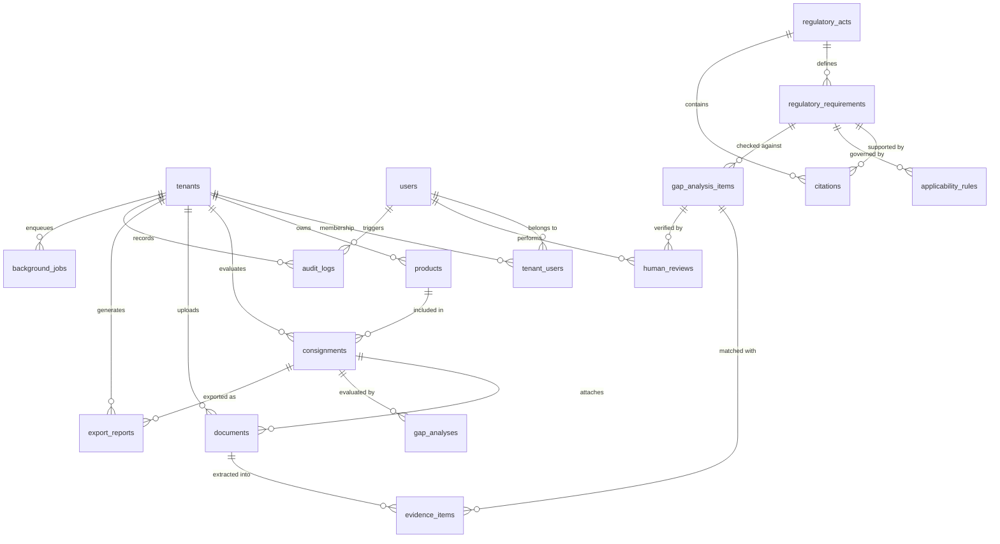

# ReguLens — Database Schema Specification (Multi-Sector Corrected)

## Document Status
- **Current Phase:** Phase 1 — Minimal Technical Foundation
- **Database Engine:** PostgreSQL 16+
- **Tenant Isolation Approach:** Defense-in-depth via Application Scoping, Composite Foreign Keys, and Database Engine Row Level Security (RLS) (`AGENTS.md` Rule 7)
- **Scope Support:** Multi-Sector Architecture supporting both **Sector 1 (Agriculture and Agri-Food)** and **Sector 2 (Textiles and Apparel)**, extensible to future sectors and destination markets.
- **Architectural Notice:** PostgreSQL Row Level Security (RLS) is a database-enforced policy boundary, NOT cryptographic tenant isolation. Security relies on the integrity of the authenticated server-side tenant context and runtime role privileges (`NOBYPASSRLS`).

---

## 1. Entity-Relationship Overview (Mermaid ERD)



---

## 2. Global Reference Tables (Public Regulatory Data)

*These tables store public, authoritative legal acts, citations, and applicability rules. They are shared globally across all tenants in read-only mode for the runtime application role (`regulens_app`). They NEVER contain customer data and do NOT have a `tenant_id`.*

### 2.1. `regulatory_acts`
Represents official legal instruments published in government gazettes or international treaties.
```sql
CREATE TABLE regulatory_acts (
    id UUID PRIMARY KEY DEFAULT gen_random_uuid(),
    official_identifier VARCHAR(128) NOT NULL UNIQUE, -- e.g., 'REG_EU_2019_1793', 'REG_EU_2023_988', 'DEC_EU_EG_1_2024'
    celex_number VARCHAR(64), -- e.g., '32019R1793', '32026R0194', '32023R0988'
    title TEXT NOT NULL,
    short_title VARCHAR(255) NOT NULL,
    issuing_authority VARCHAR(255) NOT NULL, -- e.g., 'European Commission', 'EU-Egypt Association Council'
    jurisdiction VARCHAR(64) NOT NULL, -- 'EU', 'EG'
    sector VARCHAR(64) NOT NULL DEFAULT 'CROSS_SECTOR', -- 'AGRI_FOOD', 'TEXTILES_APPAREL', 'CROSS_SECTOR'
    publication_date DATE NOT NULL,
    in_force_date DATE NOT NULL,
    application_date DATE,
    repeal_date DATE,
    lifecycle_state VARCHAR(32) NOT NULL DEFAULT 'IN_FORCE', -- 'IN_FORCE', 'PROPOSED', 'AMENDED', 'REPEALED'
    official_url TEXT NOT NULL,
    source_snapshot_hash VARCHAR(64) NOT NULL, -- SHA-256 of archived HTML/PDF file
    last_verified_at TIMESTAMPTZ NOT NULL DEFAULT CURRENT_TIMESTAMP,
    created_at TIMESTAMPTZ NOT NULL DEFAULT CURRENT_TIMESTAMP,
    updated_at TIMESTAMPTZ NOT NULL DEFAULT CURRENT_TIMESTAMP
);

CREATE INDEX idx_regulatory_acts_celex ON regulatory_acts(celex_number);
CREATE INDEX idx_regulatory_acts_lifecycle ON regulatory_acts(lifecycle_state);
CREATE INDEX idx_regulatory_acts_sector ON regulatory_acts(sector);
```

### 2.2. `regulatory_requirements`
Atomic enforceable obligations extracted from legal acts. Supports both agriculture (enhanced controls, phytosanitary, MRLs) and textiles (cords/drawstrings, flammability, fibre composition, chemical restrictions under REACH).
```sql
CREATE TABLE regulatory_requirements (
    id UUID PRIMARY KEY DEFAULT gen_random_uuid(),
    act_id UUID NOT NULL REFERENCES regulatory_acts(id) ON DELETE RESTRICT,
    requirement_code VARCHAR(64) NOT NULL UNIQUE, -- e.g., 'REQ_EU_CITRUS_PESTICIDE_CHECK', 'REQ_EU_GARMENT_CORDS_DRAWSTRINGS'
    sector VARCHAR(64) NOT NULL, -- 'AGRI_FOOD', 'TEXTILES_APPAREL', 'CROSS_SECTOR'
    category VARCHAR(64) NOT NULL, 
    -- AGRI: 'ENHANCED_OFFICIAL_CONTROLS', 'PLANT_HEALTH', 'MRL_LIMITS', 'FOOD_SAFETY'
    -- TEXTILE: 'SAFETY_STANDARDS', 'TEXTILE_LABELLING', 'CHEMICAL_RESTRICTIONS_REACH', 'FLAMMABILITY'
    -- CROSS: 'PREFERENTIAL_ORIGIN', 'GENERAL_PRODUCT_SAFETY'
    legal_reference VARCHAR(255) NOT NULL, -- e.g., 'Annex I, Citrus sinensis entry; Article 6' or 'Annex I, Entry 37; Article 7(1)(a)'
    verbatim_text TEXT NOT NULL, -- Authoritative legal text (English)
    arabic_translation TEXT, -- Informational translation
    check_frequency_percent NUMERIC(5, 2), -- Optional inspection frequency (e.g. 10.00% under Reg 2019/1793 Annex I)
    documentary_check_percent NUMERIC(5, 2), -- e.g. 100.00% under Reg 2017/625 Art 54(1) [provisional]
    required_document_type VARCHAR(64) NOT NULL, 
    -- AGRI: 'PHYTOSANITARY_CERTIFICATE', 'PESTICIDE_LAB_REPORT', 'CHED_PP', 'CHED_D'
    -- TEXTILE: 'TECHNICAL_DOSSIER_GPSR', 'OEKO_TEX_CERTIFICATE', 'LAB_TEST_REPORT_SAFETY', 'DECLARATION_OF_CONFORMITY'
    -- CROSS: 'EUR1_CERTIFICATE', 'INVOICE_DECLARATION', 'COMMERCIAL_INVOICE'
    verification_status VARCHAR(32) NOT NULL DEFAULT 'REQUIRES_HUMAN_VERIFICATION', -- 'DRAFT', 'REQUIRES_HUMAN_VERIFICATION', 'EXPERT_VERIFIED'
    created_at TIMESTAMPTZ NOT NULL DEFAULT CURRENT_TIMESTAMP,
    updated_at TIMESTAMPTZ NOT NULL DEFAULT CURRENT_TIMESTAMP
);

CREATE INDEX idx_reqs_sector_category ON regulatory_requirements(sector, category);
CREATE INDEX idx_reqs_act_id ON regulatory_requirements(act_id);
```

### 2.3. `citations`
Exact mechanical provenance linking a requirement to its location in the archived legal text snapshot.
```sql
CREATE TABLE citations (
    id UUID PRIMARY KEY DEFAULT gen_random_uuid(),
    requirement_id UUID NOT NULL REFERENCES regulatory_requirements(id) ON DELETE CASCADE,
    act_id UUID NOT NULL REFERENCES regulatory_acts(id) ON DELETE RESTRICT,
    official_source_title TEXT NOT NULL,
    official_url TEXT NOT NULL,
    quoted_excerpt TEXT NOT NULL, -- Verbatim string from source
    text_anchor_offset INT, -- Character offset in archived snapshot
    source_snapshot_hash VARCHAR(64) NOT NULL,
    last_verified_at TIMESTAMPTZ NOT NULL DEFAULT CURRENT_TIMESTAMP,
    is_valid BOOLEAN NOT NULL DEFAULT TRUE,
    created_at TIMESTAMPTZ NOT NULL DEFAULT CURRENT_TIMESTAMP
);

CREATE INDEX idx_citations_requirement ON citations(requirement_id);
```

### 2.4. `applicability_rules`
Declarative conditions evaluated deterministically to match requirements to products based on sector, HS code prefix, origin, and attributes.
```sql
CREATE TABLE applicability_rules (
    id UUID PRIMARY KEY DEFAULT gen_random_uuid(),
    requirement_id UUID NOT NULL REFERENCES regulatory_requirements(id) ON DELETE CASCADE,
    sector VARCHAR(64) NOT NULL, -- 'AGRI_FOOD', 'TEXTILES_APPAREL'
    hs_code_prefix VARCHAR(16) NOT NULL, -- e.g. '080510' (oranges), '081110' (frozen strawberries), '611120' (babies garments)
    origin_country VARCHAR(2) NOT NULL, -- 'EG'
    destination_market VARCHAR(8) NOT NULL, -- 'EU'
    condition_expression JSONB, 
    -- AGRI EXAMPLE: {"state": "fresh", "variety": "Valencia"}
    -- TEXTILE EXAMPLE: {"target_group": "children", "has_cords_or_drawstrings": true}
    is_active BOOLEAN NOT NULL DEFAULT TRUE,
    expert_reviewer_notes TEXT,
    created_at TIMESTAMPTZ NOT NULL DEFAULT CURRENT_TIMESTAMP
);

CREATE INDEX idx_rules_lookup ON applicability_rules(sector, hs_code_prefix, origin_country, destination_market);
```

---

## 3. Tenant-Owned Customer Tables (Row Level Security & Composite Integrity Enforced)

*Every tenant-owned table satisfies three mandatory architectural rules:*
1. **Direct Ownership:** Has a non-null `tenant_id UUID REFERENCES tenants(id) ON DELETE CASCADE`.
2. **Composite Uniqueness:** Has a unique constraint `UNIQUE (tenant_id, id)` enabling composite foreign-key enforcement.
3. **Composite Foreign Keys:** Child tables reference parent tables via `FOREIGN KEY (tenant_id, parent_id) REFERENCES parent_table(tenant_id, id)`. This mathematically prevents Tenant A from referencing Tenant B's data at the relational engine level, completely independent of application code.
4. **Row Level Security:** `ENABLE ROW LEVEL SECURITY` and `FORCE ROW LEVEL SECURITY` are applied to 100% of tenant tables.

### 3.1. `tenants` (Organizations)
```sql
CREATE TABLE tenants (
    id UUID PRIMARY KEY DEFAULT gen_random_uuid(),
    name VARCHAR(255) NOT NULL,
    commercial_registry_number VARCHAR(64), -- Egyptian Sijil Tijari
    tax_id VARCHAR(64),
    country VARCHAR(2) NOT NULL DEFAULT 'EG',
    is_active BOOLEAN NOT NULL DEFAULT TRUE,
    created_at TIMESTAMPTZ NOT NULL DEFAULT CURRENT_TIMESTAMP,
    updated_at TIMESTAMPTZ NOT NULL DEFAULT CURRENT_TIMESTAMP
);
```

### 3.2. `users` & `tenant_users`
```sql
CREATE TABLE users (
    id UUID PRIMARY KEY DEFAULT gen_random_uuid(),
    email VARCHAR(255) NOT NULL UNIQUE,
    password_hash VARCHAR(255) NOT NULL,
    full_name VARCHAR(255) NOT NULL,
    professional_title VARCHAR(255),
    is_active BOOLEAN NOT NULL DEFAULT TRUE,
    created_at TIMESTAMPTZ NOT NULL DEFAULT CURRENT_TIMESTAMP
);

CREATE TABLE tenant_users (
    id UUID PRIMARY KEY DEFAULT gen_random_uuid(),
    tenant_id UUID NOT NULL REFERENCES tenants(id) ON DELETE CASCADE,
    user_id UUID NOT NULL REFERENCES users(id) ON DELETE CASCADE,
    role VARCHAR(32) NOT NULL, -- 'OWNER', 'ADMIN', 'COMPLIANCE_OFFICER', 'REVIEWER', 'VIEWER'
    created_at TIMESTAMPTZ NOT NULL DEFAULT CURRENT_TIMESTAMP,
    CONSTRAINT uq_tenant_users_tenant_user UNIQUE(tenant_id, user_id),
    CONSTRAINT uq_tenant_users_tenant_id UNIQUE(tenant_id, id)
);

CREATE INDEX idx_tenant_users_tenant ON tenant_users(tenant_id);
CREATE INDEX idx_tenant_users_user ON tenant_users(user_id);
```

### 3.3. `products` (Multi-Sector Product Catalog)
Designed cleanly for both Sector 1 (Agri-food) and Sector 2 (Textiles and Apparel) without hardcoding agricultural assumptions into core fields.
```sql
CREATE TABLE products (
    id UUID PRIMARY KEY DEFAULT gen_random_uuid(),
    tenant_id UUID NOT NULL REFERENCES tenants(id) ON DELETE CASCADE,
    name VARCHAR(255) NOT NULL,
    sector VARCHAR(64) NOT NULL, -- 'AGRI_FOOD', 'TEXTILES_APPAREL'
    hs_code VARCHAR(16) NOT NULL, -- e.g., '08051000' (oranges) or '61046200' (trousers)
    origin_country VARCHAR(2) NOT NULL DEFAULT 'EG',
    description TEXT,
    attributes JSONB NOT NULL DEFAULT '{}'::jsonb,
    -- AGRI-FOOD ATTRIBUTES:
    --   {"scientific_name": "Citrus sinensis", "variety": "Valencia", "product_state": "FRESH", "intended_use": "HUMAN_CONSUMPTION"}
    -- TEXTILE ATTRIBUTES:
    --   {"fibre_composition": [{"fibre": "cotton", "percentage": 100}], "target_group": "children_under_14", "garment_type": "sleepwear", "has_cords_or_drawstrings": true}
    created_at TIMESTAMPTZ NOT NULL DEFAULT CURRENT_TIMESTAMP,
    updated_at TIMESTAMPTZ NOT NULL DEFAULT CURRENT_TIMESTAMP,
    CONSTRAINT uq_products_tenant_id UNIQUE (tenant_id, id)
);

CREATE INDEX idx_products_tenant ON products(tenant_id);
CREATE INDEX idx_products_sector ON products(tenant_id, sector);
CREATE INDEX idx_products_hs_code ON products(tenant_id, hs_code);
```

### 3.4. `consignments` (Export Evaluation Dossier)
```sql
CREATE TABLE consignments (
    id UUID PRIMARY KEY DEFAULT gen_random_uuid(),
    tenant_id UUID NOT NULL REFERENCES tenants(id) ON DELETE CASCADE,
    product_id UUID NOT NULL,
    consignment_reference VARCHAR(128) NOT NULL, -- Exporter lot number or invoice reference
    origin_country VARCHAR(2) NOT NULL DEFAULT 'EG',
    destination_market VARCHAR(8) NOT NULL DEFAULT 'EU',
    planned_shipping_date DATE,
    discharge_port VARCHAR(128),
    total_quantity NUMERIC(12, 2),
    quantity_unit VARCHAR(32) NOT NULL DEFAULT 'KG', -- 'KG', 'PIECES', 'CARTONS'
    status VARCHAR(32) NOT NULL DEFAULT 'DRAFT', -- 'DRAFT', 'UNDER_REVIEW', 'READY_FOR_EXPORT_DOSSIER'
    created_at TIMESTAMPTZ NOT NULL DEFAULT CURRENT_TIMESTAMP,
    updated_at TIMESTAMPTZ NOT NULL DEFAULT CURRENT_TIMESTAMP,
    CONSTRAINT uq_consignments_tenant_id UNIQUE (tenant_id, id),
    CONSTRAINT fk_consignments_product FOREIGN KEY (tenant_id, product_id) 
        REFERENCES products(tenant_id, id) ON DELETE RESTRICT
);

CREATE INDEX idx_consignments_tenant ON consignments(tenant_id);
```

### 3.5. `documents` (Uploaded Trade Files)
```sql
CREATE TABLE documents (
    id UUID PRIMARY KEY DEFAULT gen_random_uuid(),
    tenant_id UUID NOT NULL REFERENCES tenants(id) ON DELETE CASCADE,
    consignment_id UUID NOT NULL,
    document_type VARCHAR(64) NOT NULL, 
    -- AGRI: 'PHYTOSANITARY_CERTIFICATE', 'PESTICIDE_LAB_REPORT'
    -- TEXTILE: 'TECHNICAL_DOSSIER_GPSR', 'OEKO_TEX_CERTIFICATE', 'LAB_TEST_REPORT_SAFETY'
    -- COMMON: 'COMMERCIAL_INVOICE', 'PACKING_LIST', 'EUR1_CERTIFICATE', 'OTHER'
    file_name VARCHAR(255) NOT NULL,
    file_size_bytes BIGINT NOT NULL,
    mime_type VARCHAR(128) NOT NULL,
    storage_key VARCHAR(512) NOT NULL, -- Randomized private S3 object key
    sha256_hash VARCHAR(64) NOT NULL,
    antivirus_status VARCHAR(32) NOT NULL DEFAULT 'NOT_SCANNED', -- 'CLEAN', 'INFECTED', 'NOT_SCANNED' (dev limitation)
    parsing_status VARCHAR(32) NOT NULL DEFAULT 'UPLOADED', -- 'UPLOADED', 'PARSING', 'PARSED', 'FAILED', 'CORRUPTED'
    extracted_text TEXT,
    created_at TIMESTAMPTZ NOT NULL DEFAULT CURRENT_TIMESTAMP,
    CONSTRAINT uq_documents_tenant_id UNIQUE (tenant_id, id),
    CONSTRAINT fk_documents_consignment FOREIGN KEY (tenant_id, consignment_id) 
        REFERENCES consignments(tenant_id, id) ON DELETE CASCADE
);

CREATE INDEX idx_documents_tenant ON documents(tenant_id);
CREATE INDEX idx_documents_consignment ON documents(tenant_id, consignment_id);
```

### 3.6. `evidence_items` (Extracted Structured Entities)
Sector-agnostic entity model for structured evidence parsed from documents.
```sql
CREATE TABLE evidence_items (
    id UUID PRIMARY KEY DEFAULT gen_random_uuid(),
    tenant_id UUID NOT NULL REFERENCES tenants(id) ON DELETE CASCADE,
    document_id UUID NOT NULL,
    entity_category VARCHAR(64) NOT NULL, 
    -- AGRI: 'PESTICIDE_ACTIVE_SUBSTANCE', 'PLANT_HEALTH_DECLARATION'
    -- TEXTILE: 'FIBRE_PERCENTAGE', 'CORD_LENGTH_MEASUREMENT', 'AZO_DYE_CONCENTRATION'
    -- COMMON: 'CERTIFICATE_NUMBER', 'ISSUE_DATE', 'LAB_ACCREDITATION', 'ORIGIN_DECLARATION_TEXT'
    field_or_substance_name VARCHAR(255) NOT NULL, -- e.g. 'Chlorpyrifos' (agri) or 'Drawstring free length' (textile)
    numeric_value NUMERIC(12, 4), -- e.g. 0.0050 mg/kg or 75.00 mm
    text_value VARCHAR(255),
    unit VARCHAR(32), -- 'mg/kg', 'mm', '%', 'ISO/IEC 17025'
    page_number INT,
    quoted_excerpt TEXT,
    state VARCHAR(32) NOT NULL DEFAULT 'EXTRACTED', -- 'EXTRACTED', 'NEEDS_REVIEW'
    created_at TIMESTAMPTZ NOT NULL DEFAULT CURRENT_TIMESTAMP,
    CONSTRAINT uq_evidence_items_tenant_id UNIQUE (tenant_id, id),
    CONSTRAINT fk_evidence_document FOREIGN KEY (tenant_id, document_id) 
        REFERENCES documents(tenant_id, id) ON DELETE CASCADE
);

CREATE INDEX idx_evidence_tenant ON evidence_items(tenant_id);
CREATE INDEX idx_evidence_document ON evidence_items(tenant_id, document_id);
```

### 3.7. `gap_analyses` & `gap_analysis_items`
Explicit evidence and review state machine implementation.
```sql
CREATE TABLE gap_analyses (
    id UUID PRIMARY KEY DEFAULT gen_random_uuid(),
    tenant_id UUID NOT NULL REFERENCES tenants(id) ON DELETE CASCADE,
    consignment_id UUID NOT NULL,
    overall_status VARCHAR(64) NOT NULL, -- 'NEEDS_REVIEW', 'DEFICITS_IDENTIFIED', 'EVIDENCE_ON_FILE_SUFFICIENT', 'UNABLE_TO_ASSESS'
    executed_at TIMESTAMPTZ NOT NULL DEFAULT CURRENT_TIMESTAMP,
    CONSTRAINT uq_gap_analyses_tenant_id UNIQUE (tenant_id, id),
    CONSTRAINT fk_gap_analyses_consignment FOREIGN KEY (tenant_id, consignment_id) 
        REFERENCES consignments(tenant_id, id) ON DELETE CASCADE
);

CREATE TABLE gap_analysis_items (
    id UUID PRIMARY KEY DEFAULT gen_random_uuid(),
    tenant_id UUID NOT NULL REFERENCES tenants(id) ON DELETE CASCADE,
    gap_analysis_id UUID NOT NULL,
    requirement_id UUID NOT NULL REFERENCES regulatory_requirements(id) ON DELETE RESTRICT,
    matched_document_id UUID,
    evidence_status VARCHAR(64) NOT NULL DEFAULT 'NEEDS_REVIEW', 
    -- 'NEEDS_REVIEW', 'POTENTIAL_EXCEEDANCE', 'EVIDENCE_ON_FILE_APPARENT_MATCH', 
    -- 'EVIDENCE_ON_FILE_APPARENT_DEFICIT', 'MISSING_DOCUMENT', 'UNABLE_TO_ASSESS'
    findings_description TEXT NOT NULL,
    created_at TIMESTAMPTZ NOT NULL DEFAULT CURRENT_TIMESTAMP,
    CONSTRAINT uq_gap_analysis_items_tenant_id UNIQUE (tenant_id, id),
    CONSTRAINT fk_gap_items_analysis FOREIGN KEY (tenant_id, gap_analysis_id) 
        REFERENCES gap_analyses(tenant_id, id) ON DELETE CASCADE,
    CONSTRAINT fk_gap_items_document FOREIGN KEY (tenant_id, matched_document_id) 
        REFERENCES documents(tenant_id, id) ON DELETE SET NULL
);

CREATE INDEX idx_gap_items_tenant ON gap_analysis_items(tenant_id);
CREATE INDEX idx_gap_items_analysis ON gap_analysis_items(tenant_id, gap_analysis_id);
```

### 3.8. `human_reviews` (Human Expert Verification Protocol)
```sql
CREATE TABLE human_reviews (
    id UUID PRIMARY KEY DEFAULT gen_random_uuid(),
    tenant_id UUID NOT NULL REFERENCES tenants(id) ON DELETE CASCADE,
    gap_analysis_item_id UUID NOT NULL,
    reviewer_user_id UUID NOT NULL REFERENCES users(id) ON DELETE RESTRICT,
    reviewer_credentials VARCHAR(255) NOT NULL, -- e.g. 'Licensed Customs Consultant #4412'
    verdict VARCHAR(64) NOT NULL, 
    -- 'VERIFIED_SUFFICIENT_ON_FILE', 'VERIFIED_INSUFFICIENT_ON_FILE', 'REJECTED_DISCREPANCY'
    human_notes TEXT NOT NULL,
    reviewed_at TIMESTAMPTZ NOT NULL DEFAULT CURRENT_TIMESTAMP,
    CONSTRAINT uq_human_reviews_tenant_id UNIQUE (tenant_id, id),
    CONSTRAINT fk_human_reviews_item FOREIGN KEY (tenant_id, gap_analysis_item_id) 
        REFERENCES gap_analysis_items(tenant_id, id) ON DELETE CASCADE
);

CREATE INDEX idx_human_reviews_tenant ON human_reviews(tenant_id);
CREATE INDEX idx_human_reviews_item ON human_reviews(tenant_id, gap_analysis_item_id);
```

### 3.9. `export_reports`
```sql
CREATE TABLE export_reports (
    id UUID PRIMARY KEY DEFAULT gen_random_uuid(),
    tenant_id UUID NOT NULL REFERENCES tenants(id) ON DELETE CASCADE,
    consignment_id UUID NOT NULL,
    report_version INT NOT NULL DEFAULT 1,
    storage_key VARCHAR(512) NOT NULL,
    sha256_checksum VARCHAR(64) NOT NULL,
    mandatory_disclaimer_included BOOLEAN NOT NULL DEFAULT TRUE,
    generated_by_user_id UUID NOT NULL REFERENCES users(id) ON DELETE RESTRICT,
    created_at TIMESTAMPTZ NOT NULL DEFAULT CURRENT_TIMESTAMP,
    CONSTRAINT uq_export_reports_tenant_id UNIQUE (tenant_id, id),
    CONSTRAINT fk_export_reports_consignment FOREIGN KEY (tenant_id, consignment_id) 
        REFERENCES consignments(tenant_id, id) ON DELETE RESTRICT
);

CREATE INDEX idx_reports_tenant ON export_reports(tenant_id);
```

### 3.10. `background_jobs` (PostgreSQL Queue)
```sql
CREATE TABLE background_jobs (
    id UUID PRIMARY KEY DEFAULT gen_random_uuid(),
    tenant_id UUID NOT NULL REFERENCES tenants(id) ON DELETE CASCADE,
    job_type VARCHAR(64) NOT NULL, -- 'DOCUMENT_PARSE', 'EVIDENCE_EXTRACT', 'REPORT_GENERATE'
    payload JSONB NOT NULL,
    status VARCHAR(32) NOT NULL DEFAULT 'QUEUED', -- 'QUEUED', 'PROCESSING', 'COMPLETED', 'FAILED'
    attempts INT NOT NULL DEFAULT 0,
    max_attempts INT NOT NULL DEFAULT 3,
    run_at TIMESTAMPTZ NOT NULL DEFAULT CURRENT_TIMESTAMP,
    locked_at TIMESTAMPTZ,
    locked_by VARCHAR(128),
    error_message TEXT,
    created_at TIMESTAMPTZ NOT NULL DEFAULT CURRENT_TIMESTAMP,
    updated_at TIMESTAMPTZ NOT NULL DEFAULT CURRENT_TIMESTAMP,
    CONSTRAINT uq_background_jobs_tenant_id UNIQUE (tenant_id, id)
);

CREATE INDEX idx_jobs_poll ON background_jobs (status, run_at) WHERE status = 'QUEUED';
CREATE INDEX idx_jobs_tenant ON background_jobs (tenant_id);
```

### 3.11. `audit_logs` (Immutable Audit Trail)
```sql
CREATE TABLE audit_logs (
    id UUID PRIMARY KEY DEFAULT gen_random_uuid(),
    tenant_id UUID REFERENCES tenants(id) ON DELETE SET NULL,
    user_id UUID REFERENCES users(id) ON DELETE SET NULL,
    action VARCHAR(128) NOT NULL, -- 'DOCUMENT_UPLOAD', 'EXPERT_VERIFY', 'REPORT_DOWNLOAD'
    resource_type VARCHAR(64) NOT NULL,
    resource_id UUID NOT NULL,
    ip_address VARCHAR(45),
    user_agent TEXT,
    details JSONB,
    created_at TIMESTAMPTZ NOT NULL DEFAULT CURRENT_TIMESTAMP,
    CONSTRAINT uq_audit_logs_tenant_id UNIQUE (tenant_id, id)
);

CREATE INDEX idx_audit_tenant_created ON audit_logs(tenant_id, created_at DESC);
```

---

## 4. PostgreSQL Row Level Security (RLS) Configuration

RLS is enabled and forced on ALL customer-associated tables.

```sql
-- 1. tenants table
ALTER TABLE tenants ENABLE ROW LEVEL SECURITY;
ALTER TABLE tenants FORCE ROW LEVEL SECURITY;
CREATE POLICY rls_tenants ON tenants
    FOR SELECT
    USING (id = current_setting('app.current_tenant_id', true)::uuid);

-- 2. tenant_users table
ALTER TABLE tenant_users ENABLE ROW LEVEL SECURITY;
ALTER TABLE tenant_users FORCE ROW LEVEL SECURITY;
CREATE POLICY rls_tenant_users ON tenant_users
    FOR ALL
    USING (tenant_id = current_setting('app.current_tenant_id', true)::uuid)
    WITH CHECK (tenant_id = current_setting('app.current_tenant_id', true)::uuid);

-- 3. products table
ALTER TABLE products ENABLE ROW LEVEL SECURITY;
ALTER TABLE products FORCE ROW LEVEL SECURITY;
CREATE POLICY rls_products ON products
    FOR ALL
    USING (tenant_id = current_setting('app.current_tenant_id', true)::uuid)
    WITH CHECK (tenant_id = current_setting('app.current_tenant_id', true)::uuid);

-- 4. consignments table
ALTER TABLE consignments ENABLE ROW LEVEL SECURITY;
ALTER TABLE consignments FORCE ROW LEVEL SECURITY;
CREATE POLICY rls_consignments ON consignments
    FOR ALL
    USING (tenant_id = current_setting('app.current_tenant_id', true)::uuid)
    WITH CHECK (tenant_id = current_setting('app.current_tenant_id', true)::uuid);

-- 5. documents table
ALTER TABLE documents ENABLE ROW LEVEL SECURITY;
ALTER TABLE documents FORCE ROW LEVEL SECURITY;
CREATE POLICY rls_documents ON documents
    FOR ALL
    USING (tenant_id = current_setting('app.current_tenant_id', true)::uuid)
    WITH CHECK (tenant_id = current_setting('app.current_tenant_id', true)::uuid);

-- 6. evidence_items table
ALTER TABLE evidence_items ENABLE ROW LEVEL SECURITY;
ALTER TABLE evidence_items FORCE ROW LEVEL SECURITY;
CREATE POLICY rls_evidence_items ON evidence_items
    FOR ALL
    USING (tenant_id = current_setting('app.current_tenant_id', true)::uuid)
    WITH CHECK (tenant_id = current_setting('app.current_tenant_id', true)::uuid);

-- 7. gap_analyses table
ALTER TABLE gap_analyses ENABLE ROW LEVEL SECURITY;
ALTER TABLE gap_analyses FORCE ROW LEVEL SECURITY;
CREATE POLICY rls_gap_analyses ON gap_analyses
    FOR ALL
    USING (tenant_id = current_setting('app.current_tenant_id', true)::uuid)
    WITH CHECK (tenant_id = current_setting('app.current_tenant_id', true)::uuid);

-- 8. gap_analysis_items table
ALTER TABLE gap_analysis_items ENABLE ROW LEVEL SECURITY;
ALTER TABLE gap_analysis_items FORCE ROW LEVEL SECURITY;
CREATE POLICY rls_gap_analysis_items ON gap_analysis_items
    FOR ALL
    USING (tenant_id = current_setting('app.current_tenant_id', true)::uuid)
    WITH CHECK (tenant_id = current_setting('app.current_tenant_id', true)::uuid);

-- 9. human_reviews table
ALTER TABLE human_reviews ENABLE ROW LEVEL SECURITY;
ALTER TABLE human_reviews FORCE ROW LEVEL SECURITY;
CREATE POLICY rls_human_reviews ON human_reviews
    FOR ALL
    USING (tenant_id = current_setting('app.current_tenant_id', true)::uuid)
    WITH CHECK (tenant_id = current_setting('app.current_tenant_id', true)::uuid);

-- 10. export_reports table
ALTER TABLE export_reports ENABLE ROW LEVEL SECURITY;
ALTER TABLE export_reports FORCE ROW LEVEL SECURITY;
CREATE POLICY rls_export_reports ON export_reports
    FOR ALL
    USING (tenant_id = current_setting('app.current_tenant_id', true)::uuid)
    WITH CHECK (tenant_id = current_setting('app.current_tenant_id', true)::uuid);

-- 11. background_jobs table
ALTER TABLE background_jobs ENABLE ROW LEVEL SECURITY;
ALTER TABLE background_jobs FORCE ROW LEVEL SECURITY;
CREATE POLICY rls_background_jobs ON background_jobs
    FOR ALL
    USING (tenant_id = current_setting('app.current_tenant_id', true)::uuid)
    WITH CHECK (tenant_id = current_setting('app.current_tenant_id', true)::uuid);

-- 12. audit_logs table (Immutable: SELECT and INSERT only)
ALTER TABLE audit_logs ENABLE ROW LEVEL SECURITY;
ALTER TABLE audit_logs FORCE ROW LEVEL SECURITY;
CREATE POLICY rls_audit_logs_select ON audit_logs
    FOR SELECT
    USING (tenant_id = current_setting('app.current_tenant_id', true)::uuid);
CREATE POLICY rls_audit_logs_insert ON audit_logs
    FOR INSERT
    WITH CHECK (tenant_id = current_setting('app.current_tenant_id', true)::uuid);
```

---

## 5. Database Roles & Permission Boundaries

```sql
-- Application runtime role (least privilege)
CREATE ROLE regulens_app WITH LOGIN NOBYPASSRLS;

-- Grant DML permissions on tenant tables
GRANT SELECT, INSERT, UPDATE, DELETE ON 
    tenants, tenant_users, products, consignments, documents, 
    evidence_items, gap_analyses, gap_analysis_items, human_reviews, 
    export_reports, background_jobs 
TO regulens_app;

-- Grant append-only and read permissions on audit_logs (NO UPDATE, NO DELETE)
GRANT SELECT, INSERT ON audit_logs TO regulens_app;
REVOKE UPDATE, DELETE ON audit_logs FROM regulens_app;

-- Grant read-only permissions on global regulatory reference tables
GRANT SELECT ON regulatory_acts, regulatory_requirements, citations, applicability_rules 
TO regulens_app;
REVOKE INSERT, UPDATE, DELETE ON regulatory_acts, regulatory_requirements, citations, applicability_rules 
FROM regulens_app;
```
