# ReguLens — Development Roadmap & Milestone Plan

## Document Status
- **Current Phase:** Phase 0B — Technical Architecture & MVP Definition
- **Governance Reference:** `phases/ROADMAP.md` is the sole authority on phase ordering. This document adds milestones, technical deliverables, and exit details inside that order without reordering phases.
- **Rule:** Stop at every gate and wait for the founder's explicit written approval.

---

## 1. Master Phase Sequence

```mermaid
graph LR
    P0A["Phase 0A: Research & Validation<br>(Completed & Audited)"] --> P0B["Phase 0B: Architecture & MVP Plan<br>(Current Phase)"]
    P0B -->|Gate B Approval| P1["Phase 1: Minimal Technical Foundation<br>(Auth, RLS, Storage, CI)"]
    P1 -->|Gate 1 Approval| P2["Phase 2: Vertical Slice<br>(Egyptian Oranges to EU)"]
    P2 -->|Gate 2 + Expert Review| P3["Phase 3: Expansion<br>(Strawberries, Apparel, Billing)"]
    P3 -->|Gate 3 Approval| P4["Phase 4: Hardening & Scale<br>(Enterprise, Multi-Lane)"]
```

---

## 2. Milestone Breakdown & Exit Criteria

### Phase 0A: Market & Scope Validation (COMPLETED)
- **Status:** COMPLETED and verified via `docs/PHASE_0A_EVIDENCE_AUDIT.md`.
- **Outputs:** `MARKET_RESEARCH.md`, `CUSTOMER_RESEARCH.md`, `COMPETITOR_ANALYSIS.md`, `REGULATORY_SOURCES.md`, `PHASE_0A_EVIDENCE_AUDIT.md`.

---

### Phase 0B: Technical Architecture & MVP Definition (CURRENT)
- **Goal:** Define product requirements, minimal architecture, database schema, security model, threat model, data retention, draft privacy policy, and test strategy sized strictly to the Vertical Slice.
- **Deliverables:**
  - `docs/PRODUCT_REQUIREMENTS.md` (PRD with 8-step journey, JTBD, user stories)
  - `docs/SYSTEM_ARCHITECTURE.md` (Minimal baseline, data flows, bilingual RTL/LTR)
  - `docs/DATABASE_SCHEMA.md` (Relational schema, Mermaid ERD, RLS policies)
  - `docs/SECURITY_ARCHITECTURE.md` (Multi-layer defense, secrets, audit logging)
  - `docs/THREAT_MODEL.md` (STRIDE threat model, prompt injection defenses)
  - `docs/REGULATORY_DATA_POLICY.md` (Source tiers, verification, licensing)
  - `docs/TEST_STRATEGY.md` (Test pyramid, PROPOSED metrics & golden dataset)
  - `docs/DATA_RETENTION_POLICY.md` & `docs/PRIVACY_POLICY_DRAFT.md` (Drafts)
  - `docs/DEVELOPMENT_ROADMAP.md` (This document)
  - `docs/OPEN_QUESTIONS.md` (Open ambiguities with recommended defaults)
  - ADRs in `docs/adr/` (`0001` through `0007`)
- **Exit Gate (Gate B):** Founder reviews all Phase 0B deliverables and provides explicit written approval before any code or package initialization occurs.

---

### Phase 1: Minimal Technical Foundation (NEXT PHASE)
- **Entry Condition:** Gate B written approval from founder.
- **Goal:** Build and verify the secure, testable multi-tenant foundation without application business logic.
- **Technical Milestones:**
  - **M1.1: Project Scaffolding & Monorepo Setup:**
    - Next.js 15 (TypeScript) frontend repository initialization.
    - FastAPI (Python 3.12) backend repository initialization with Pydantic v2 and SQLAlchemy 2.0.
    - Docker Compose for local PostgreSQL 16 and MinIO object storage.
  - **M1.2: Database & Tenant Isolation (RLS):**
    - Alembic migrations for `tenants`, `users`, `tenant_users`, and `audit_logs`.
    - PostgreSQL RLS policies enabled and enforced.
    - Automated tenant isolation test suite passing in CI.
  - **M1.3: Authentication & Authorization:**
    - Session JWT in HttpOnly secure cookies.
    - RBAC middleware (`Owner`, `Admin`, `Compliance Officer`, `Reviewer`, `Viewer`).
    - Negative authorization integration tests.
  - **M1.4: Private File Storage Pipeline:**
    - S3 integration with pre-signed temporary URLs (15-min expiry).
    - MIME magic-byte validation and ClamAV scanning integration.
  - **M1.5: Continuous Integration (CI):**
    - GitHub Actions pipeline running linting (Ruff, ESLint), type-checking (MyPy, TypeScript), unit tests, and security tests on every commit.
- **Exit Gate (Gate 1):** Working foundation; 100% test pass rate; zero code vulnerabilities; written founder sign-off.

---

### Phase 2: The Vertical Slice (MVP)
- **Entry Condition:** Gate 1 written approval from founder.
- **Scope:** Fresh Egyptian Valencia Oranges (CN `0805 10 00`) exported to the European Union.
- **Technical Milestones:**
  - **M2.1: Regulatory Knowledge Base & Deterministic Rules:**
    - Ingestion and hashing of official EU texts (Reg 2016/2031, Reg 2019/2072, Reg 2019/1793 as amended by Reg 2026/194, Reg 396/2005, Decision 1/2024).
    - Seed `regulatory_acts`, `regulatory_requirements`, `citations`, and `applicability_rules`.
    - Citation validation engine checking source snapshot hashes and verbatim text anchors.
  - **M2.2: Consignment Management & Document Upload UI:**
    - Bilingual RTL/LTR UI in Next.js (`next-intl`, Cairo font).
    - Exporter product profile creation (Valencia Oranges).
    - Document upload interface (Phytosanitary Certificate, Lab Report, EUR.1, Invoice).
  - **M2.3: Document Text Extraction & AI Adapter:**
    - Async worker processing `background_jobs` table via `SELECT ... FOR UPDATE SKIP LOCKED`.
    - `pdfplumber` text extraction.
    - `AIProviderAdapter` with structural XML prompt isolation and Pydantic schema validation.
    - Regex fallback extraction engine for offline resilience.
  - **M2.4: Deterministic Gap Analysis Engine:**
    - Matching extracted document entities against regulatory requirements.
    - Automated MRL threshold exceedance checks.
    - Automated missing document detection.
    - Labeling all findings `Requires human verification`.
  - **M2.5: Human Reviewer Interface:**
    - Side-by-side evidence inspection view for qualified human reviewers.
    - Review verdict submission (`VERIFIED_SUFFICIENT_ON_FILE` / `VERIFIED_INSUFFICIENT_ON_FILE`) with required credentials and notes.
    - Immutable audit trail recording.
  - **M2.6: Versioned PDF Report Generation:**
    - WeasyPrint / ReportLab engine compiling tamper-evident PDF dossiers.
    - Mandatory verbatim disclaimer prominently rendered on Page 1.
    - Traceability matrix embedding exact legal citations and reviewer sign-offs.
  - **M2.7: Golden Dataset Verification & Quality Gate Audit:**
    - Execution of the 25-case Golden Dataset against the proposed quantitative thresholds.
    - Physical expert review of the regulatory requirements sample recorded.
- **Exit Gate (Gate 2):** Complete working journey; quantitative metrics measured and reported honestly; expert review completed; founder written approval.

---

### Phase 3: Expansion & Monetization (FUTURE)
- **Entry Condition:** Gate 2 written approval and customer validation evidence.
- **Scope:**
  - Addition of Egyptian Frozen Strawberries (CN `0811 10`) and Children's Apparel (GPSR / EN 14682).
  - Automated Regulatory Change Monitoring & Alerts (daily EUR-Lex RSS/API polling).
  - Subscription & Billing Integration (Stripe or regional Egyptian payment gateway, pending business entity registration).
  - Multi-lane support (GCC destination market requirements).

---

### Phase 4: Hardening & Enterprise Scale (FUTURE)
- **Scope:**
  - Dedicated background queue workers (if task volume warrants offloading from PostgreSQL).
  - SOC2 / ISO 27001 readiness review and formal security penetration testing.
  - Enterprise SSO (SAML 2.0 / Okta).
