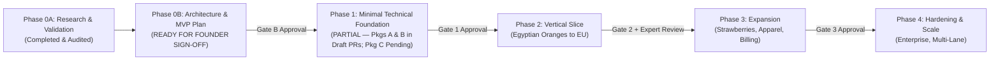

# ReguLens — Development Roadmap & Milestone Plan

## Document Status
- **Current Phase:** Phase 1 — Minimal Technical Foundation (In Progress: Package A & Package B complete in Draft PRs; Package C pending)
- **Selected First Vertical Slice (Phase 2):** **Fresh Egyptian Valencia Oranges (CN `0805 10 00`) exported to the European Union (EU-27)**. Formally approved by the founder as the first vertical slice to validate the end-to-end user journey across multi-regime checks.
- **Future Expansion Direction:** The broader multi-sector strategy (citrus + strawberries, ready-made garments, children's apparel) remains the overall product architecture and strategic expansion direction for Phase 3 and later, subject to post-slice customer interviews and Eurostat Comext trade evidence. Do not silently change the overall product strategy.
- **Approved Acceptance Targets (Targets Approved by Founder; NOT Achieved Results):**
  - Citation Validity: 100%
  - Citation Support: ≥98%
  - Requirement Extraction Precision: ≥95%
  - Requirement Extraction Recall: ≥95%
  - Unsupported-Claim Rate: 0%
  - Source Freshness: 100% within defined freshness thresholds, otherwise a visible degraded-status warning.
  - Golden Dataset: 25 curated, human-verified test cases.
  *(Note: These are approved targets, NOT achieved results. They must be empirically measured on the golden dataset during Phase 2).*
- **Governance Reference:** `phases/ROADMAP.md` is the sole authority on phase ordering. This document adds milestones, technical deliverables, and exit details inside that order without reordering phases.
- **Rule:** Stop at every gate and wait for the founder's explicit written approval.

---

## 1. Master Phase Sequence

---

## 2. Milestone Breakdown & Exit Criteria

### Phase 0A: Market & Scope Validation (COMPLETED)
- **Status:** COMPLETED and verified via `docs/PHASE_0A_EVIDENCE_AUDIT.md`.
- **Outputs:** `MARKET_RESEARCH.md`, `CUSTOMER_RESEARCH.md`, `COMPETITOR_ANALYSIS.md`, `REGULATORY_SOURCES.md`, `PHASE_0A_EVIDENCE_AUDIT.md`.

---

### Phase 0B: Technical Architecture & MVP Definition (READY FOR FOUNDER SIGN-OFF)
- **Status:** READY FOR FOUNDER SIGN-OFF — final founder review pending. Architecture, PRD, database schema, threat model, security model, data retention, draft privacy policy, test strategy, and ADRs (0001–0008) delivered. Founder has approved quantitative acceptance targets and the first vertical slice.
- **Goal:** Define product requirements, minimal architecture, database schema, security model, threat model, data retention, draft privacy policy, and test strategy sized strictly to the Vertical Slice.
- **Deliverables:**
  - `docs/PRODUCT_REQUIREMENTS.md` (PRD with 8-step journey, JTBD, user stories)
  - `docs/SYSTEM_ARCHITECTURE.md` (Minimal baseline, data flows, bilingual RTL/LTR)
  - `docs/DATABASE_SCHEMA.md` (Relational schema, Mermaid ERD, RLS policies)
  - `docs/SECURITY_ARCHITECTURE.md` (Multi-layer defense, secrets, audit logging)
  - `docs/THREAT_MODEL.md` (STRIDE threat model, prompt injection defenses)
  - `docs/REGULATORY_DATA_POLICY.md` (Source tiers, verification, licensing)
  - `docs/TEST_STRATEGY.md` (Test pyramid, APPROVED targets & golden dataset specification)
  - `docs/DATA_RETENTION_POLICY.md` & `docs/PRIVACY_POLICY_DRAFT.md` (Drafts)
  - `docs/DEVELOPMENT_ROADMAP.md` (This document)
  - `docs/OPEN_QUESTIONS.md` (Open ambiguities with recommended defaults)
  - ADRs in `docs/adr/` (`0001` through `0008`)
- **Exit Gate (Gate B):** READY FOR FOUNDER SIGN-OFF — final founder review pending.

---

### Phase 1: Minimal Technical Foundation (READY FOR FOUNDER SIGN-OFF)
- **Entry Condition:** Gate B written approval from founder.
- **Status:** READY FOR FOUNDER SIGN-OFF — Packages A, B, and C implemented in Draft PRs (#1, #2, #3); test suite expanded to 119 tests; remaining CI gaps documented; awaiting final founder sign-off.
- **Goal:** Build and verify the secure, testable multi-tenant foundation without application business logic.
- **Work Package Structure & Milestones:**
  - **Package A: Multi-Tenant RLS Session Context & GUC Enforcement (COMPLETED in Draft PR #1):**
    - Transaction-local GUC configuration (`app.current_tenant_id`, `app.current_user_id`).
    - PostgreSQL connection checkout/checkin listener with reset on pool return.
    - Defensive `SessionLocal` guard raising `RuntimeError` if invoked without explicit tenant/user context.
    - Alembic migrations 0001 & 0002.
    - Verified by CI Run #43624757872.
  - **Package B: Token-Bound Multi-Tenant Switching & Live Role Authorization (COMPLETED in Draft PR #2):**
    - Tenant discovery (`GET /auth/memberships`).
    - Token-bound tenant switching (`POST /auth/switch-tenant`) issuing tenant-scoped access tokens.
    - Live role authorization via `get_current_tenant_user` and `require_owner` preventing privilege escalation from stale JWT role claims.
    - User-scoped RLS policies on `tenants` and `tenant_users` via Alembic migration 0003.
    - Full FastAPI dependency chain integration tests (`tests/integration/test_fastapi_tenant_authorization.py`).
    - Verified by CI Run #43624757872 (82 passed tests, 44 RLS security tests).
  - **Package C: Private File Storage Pipeline & Upload Security (COMPLETED in Draft PR #3):**
    - S3/GCS private storage integration with pre-signed temporary URLs (15-min expiry).
    - MIME magic-byte validation (`file_validation.py`), file size limits (25MB hard cap).
    - SHA-256 payload checksum verification on upload.
    - Malware scanning subsystem (`scanner.py`, `ClamAVScanner`, `MockMalwareScanner` detecting EICAR, fail-safe error handling).
    - Two-phase upload lifecycle (`initiate-upload`, `finalize-upload`) with quarantine isolation.
    - Authenticated download URL generation with status check and role-based deletion with storage purge.
    - Alembic migration `0004_document_storage_fields.py` with bidirectional rollback verification.
    - 21 integration tests in `tests/integration/test_document_lifecycle.py` and 4 unit test suites.
  - **Exit Gate (Gate 1):** READY FOR FOUNDER SIGN-OFF — Packages A, B, and C implemented in Draft PRs (#1, #2, #3); remaining CI and verification gaps documented; awaiting founder sign-off.

---

### Phase 2: The Vertical Slice (MVP)
- **Entry Condition:** Gate 1 written approval from founder.
- **Scope:** Fresh Egyptian Valencia Oranges (CN `0805 10 00`) exported to the European Union.
- **Technical Milestones:**
  - **M2.1: Regulatory Knowledge Base & Deterministic Rules:**
    - Ingestion and hashing of official EU texts (Reg 2016/2031, Reg 2019/2072, Reg 2019/1793 as amended by Reg 2026/194, Reg 396/2005, Decision 1/2024).
    - Seed `regulatory_acts`, `regulatory_requirements`, `citations`, and `applicability_rules`.
    - Citation validation engine checking source snapshot hashes and verbatim text anchors.
  - **M2.2: Consignment Management & Document Upload UI:**
    - Bilingual RTL/LTR UI in Next.js (`next-intl`, Cairo font).
    - Exporter product profile creation (Valencia Oranges).
    - Document upload interface (Phytosanitary Certificate, Lab Report, EUR.1, Invoice).
  - **M2.3: Document Text Extraction & AI Adapter:**
    - Async worker processing `background_jobs` table via `SELECT ... FOR UPDATE SKIP LOCKED`.
    - `pdfplumber` text extraction.
    - `AIProviderAdapter` with structural XML prompt isolation and Pydantic schema validation.
    - Regex fallback extraction engine for offline resilience.
  - **M2.4: Deterministic Gap Analysis Engine:**
    - Matching extracted document entities against regulatory requirements.
    - Automated MRL threshold exceedance checks.
    - Automated missing document detection.
    - Labeling all findings `Requires human verification`.
  - **M2.5: Human Reviewer Interface:**
    - Side-by-side evidence inspection view for qualified human reviewers.
    - Review verdict submission (`VERIFIED_SUFFICIENT_ON_FILE` / `VERIFIED_INSUFFICIENT_ON_FILE`) with required credentials and notes.
    - Immutable audit trail recording.
  - **M2.6: Versioned PDF Report Generation:**
    - WeasyPrint / ReportLab engine compiling tamper-evident PDF dossiers.
    - Mandatory verbatim disclaimer prominently rendered on Page 1.
    - Traceability matrix embedding exact legal citations and reviewer sign-offs.
  - **M2.7: Golden Dataset Verification & Quality Gate Audit:**
    - Execution of the 25-case Golden Dataset against the proposed quantitative thresholds.
    - Physical expert review of the regulatory requirements sample recorded.
- **Exit Gate (Gate 2):** Complete working journey; quantitative metrics measured and reported honestly; expert review completed; founder written approval.

---

### Phase 3: Expansion & Monetization (FUTURE)
- **Entry Condition:** Gate 2 written approval and customer validation evidence.
- **Scope:**
  - Addition of Egyptian Frozen Strawberries (CN `0811 10`) and Children's Apparel (GPSR / EN 14682).
  - Automated Regulatory Change Monitoring & Alerts (daily EUR-Lex RSS/API polling).
  - Subscription & Billing Integration (Stripe or regional Egyptian payment gateway, pending business entity registration).
  - Multi-lane support (GCC destination market requirements).

---

### Phase 4: Hardening & Enterprise Scale (FUTURE)
- **Scope:**
  - Dedicated background queue workers (if task volume warrants offloading from PostgreSQL).
  - SOC2 / ISO 27001 readiness review and formal security penetration testing.
  - Enterprise SSO (SAML 2.0 / Okta).
