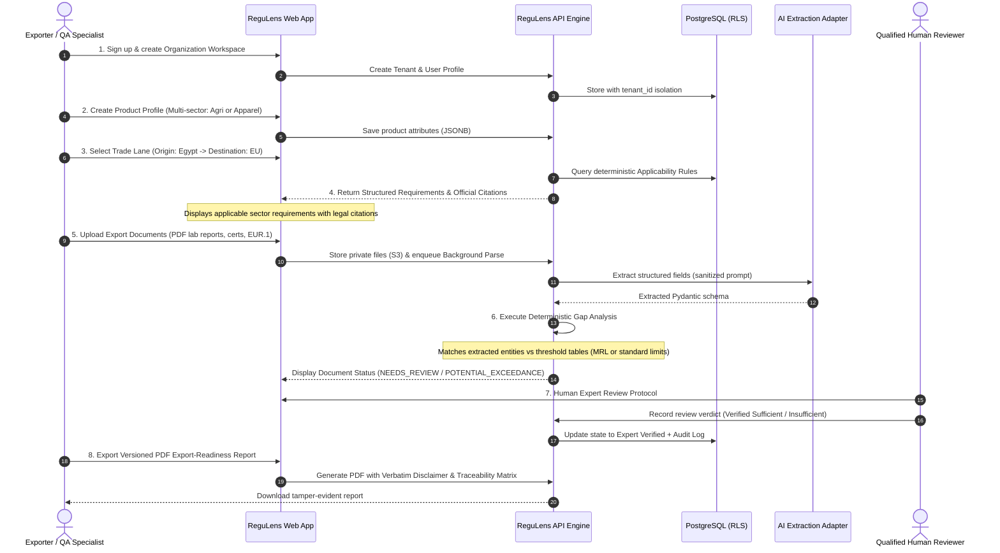

# ReguLens — Product Requirements Document (PRD) (Multi-Sector Corrected)

## Document Status
- **Current Phase:** Phase 1 — Minimal Technical Foundation
- **Approved Strategic Scope:** Multi-Sector Regulatory Intelligence Platform supporting:
  - **Sector 1: Agriculture and Agri-food** (Fresh oranges, fresh strawberries, frozen strawberries, fresh vegetables, processed food)
  - **Sector 2: Textiles and Apparel** (Ready-made garments, children's clothing, fabrics, home textiles)
- **Provisional Test Case Status:** Fresh Egyptian Valencia Oranges (CN `0805 10 00`) to the European Union serves strictly as a **provisional engineering test case** for the first vertical slice to exercise multi-regime checks. It is NOT the entire product scope or a final commercial product decision. Commercial vertical selection remains subject to customer interviews and Comext trade evidence.
- **Mandatory Report Disclaimer (verbatim):**
  > "This report provides regulatory research and compliance-support information based on the sources and product information available at the time of generation. It is not an official government approval, certification, legal opinion or guarantee of market access. Requirements should be verified with the relevant authorities and qualified professionals."

---

## 1. Executive Summary & Product Vision

ReguLens is a regulatory-intelligence and export-readiness assistance B2B SaaS platform. It enables manufacturers, agricultural producers, garment makers, and exporters to determine official requirements for selling products into foreign destination markets, match export documentation against those requirements, detect missing or deficient evidence, and generate audit-grade, traceable research reports.

### Constitutional Boundaries (`AGENTS.md`)
1. **ReguLens is NOT a government agency, customs authority, certification body, accredited laboratory, or law firm.**
2. **ReguLens NEVER states that a product "is compliant" or guarantees customs clearance.** It states what cited official sources require, what documentary evidence is on file, and what gaps remain.
3. **Five Separate Realities:** Identifying a requirement, identifying its documents, checking a document exists, judging whether evidence looks sufficient, and establishing legal compliance are five distinct concepts. ReguLens strictly separates them.
4. **Traceability:** Every requirement displayed carries a verifiable citation to an official government record (official URL, issuing authority, legal act reference, last-verified date).
5. **Human Verification:** All automated evaluations are labeled *"Requires human verification"* until confirmed by a qualified human export/customs expert.

---

## 2. Multi-Sector Scope & Personas

### Sector 1: Agriculture and Agri-Food
- **Exemplar Trade Flows:** Fresh Valencia oranges, fresh strawberries, frozen strawberries to EU-27.
- **Key Regimes:** Plant health phytosanitary certificates (Reg 2016/2031 & 2019/2072), enhanced official food safety controls (Reg 2019/1793 amended by Reg 2026/194), TRACES NT (CHED-PP / CHED-D), pesticide Maximum Residue Limits (Reg 396/2005), and preferential origin (EUR.1 / Decision 1/2024).

### Sector 2: Textiles and Apparel
- **Exemplar Trade Flows:** Ready-made cotton garments, children's sleepwear, fabrics to EU-27.
- **Key Regimes:** General Product Safety Regulation (GPSR - Reg 2023/988), Harmonised standard EN 14682:2014 (cords and drawstrings on children's clothing per Implementing Decision 2026/901 Annex I Entry 37), Textile Fibre Labelling (Reg 1007/2011), REACH Annex XVII chemical restrictions (azo dyes, nickel), and preferential origin list rules (Decision 1/2024).

### Personas & Jobs-to-be-Done (JTBD)
- **Tarek (Agricultural Export Director):** Wants to verify that citrus consignments meet EU enhanced control sampling rates (10% under Reg 2026/194) and pesticide MRLs before maritime shipping.
- **Nour (Apparel Compliance Manager):** Wants to verify that children's sleepwear designs meet GPSR cord and drawstring safety standards (EN 14682) and that accredited lab test reports for azo dyes are on file before dispatching air cargo to European retailers.
- **Ahmed (Freight Forwarding Clerk):** Assembles customs dossiers, invoices, and EUR.1 preferential origin proofs across both agricultural and textile shipments.

---

## 3. The 8-Step MVP User Journey (Provisional Test Case: Citrus)

### Detailed Functional Steps

#### Step 1: Workspace & Team Setup
- Exporter registers account and creates Organization Workspace (`Tenant`).
- Assigns role-based permissions (`Owner`, `Admin`, `Compliance Officer`, `Reviewer`, `Viewer`).

#### Step 2: Product Profile Creation (Multi-Sector)
- Exporter inputs product details:
  - Selects Sector: `AGRI_FOOD` or `TEXTILES_APPAREL`.
  - Input Name, HS / CN Code (e.g. `0805 10 00` for oranges, `6104 62 00` for cotton trousers).
  - Attributes JSONB:
    - *Agri-food:* `{"scientific_name": "Citrus sinensis", "variety": "Valencia", "product_state": "FRESH"}`
    - *Apparel:* `{"target_group": "children_under_14", "fibre_composition": [{"fibre": "cotton", "percentage": 100}], "has_cords_or_drawstrings": true}`

#### Step 3: Origin & Destination Selection
- Origin: Egypt (`EG`); Destination: European Union (`EU`).

#### Step 4: Deterministic Requirement Retrieval
- Evaluates declarative rules matching sector, HS code, origin, and attributes:
  - **For Fresh Oranges (Provisional Test Case):**
    1. *Enhanced Official Controls:* Reg (EU) 2019/1793 Annex I (amended by Reg (EU) 2026/194). Single combined frequency of **10% for identity and physical checks**.
    2. *Documentary Checks:* Reg (EU) 2017/625 Art 54(1) requiring **100% documentary checks** [provisional citation].
    3. *Plant Health:* Reg (EU) 2016/2031 Art 71 & Reg (EU) 2019/2072 Annex XI. Mandatory Phytosanitary Certificate.
    4. *Border Portals:* TRACES NT CHED-PP and CHED-D [provisional workflow].
    5. *Pesticide Residue Limits:* Reg (EC) No 396/2005 MRL thresholds.
    6. *Preferential Origin:* Decision No 1/2024 EUR.1 Movement Certificate or Invoice Declaration.
  - **For Children's Apparel (Textile Extension):**
    1. *General Product Safety:* Reg (EU) 2023/988 (GPSR).
    2. *Harmonised Standard:* EN 14682:2014 (cords and drawstrings) per Decision 2026/901 Annex I Entry 37.
    3. *Textile Labelling:* Reg (EU) No 1007/2011 fibre composition.
    4. *REACH Chemical Restrictions:* Reg (EC) No 1907/2006 Annex XVII (azo dyes < 30 mg/kg).
    5. *Preferential Origin:* Decision No 1/2024 origin list rules for Chapters 61/62.

#### Step 5: Document Upload & Parsing
- User uploads export consignment files (PDF, PNG, JPG; max 25MB):
  - Agri: Phytosanitary cert, accredited pesticide lab report, EUR.1, invoice.
  - Apparel: Lab safety test report (drawstrings/flammability/azo dyes), technical dossier, invoice.
- Files stored in private S3 bucket; text extracted via unprivileged PDF parser.
- AI adapter parses text inside structural XML delimiters into Pydantic models.

#### Step 6: Automated Gap Analysis
- Engine compares extracted document attributes against regulatory requirements:
  - **Presence Check:** Mandatory certificates present?
  - **Threshold Check:** Numeric values compared deterministically:
    - If pesticide level > EU MRL -> State set to `POTENTIAL_EXCEEDANCE` (Assessment requiring verification, NOT a final legal judgment).
    - If drawstring free length > standard limit -> State set to `POTENTIAL_EXCEEDANCE`.
  - **Freshness Check:** Sample date within acceptable window.

#### Step 7: Human Expert Review Protocol
- Status badge displayed: `Status: Requires human verification`.
- Qualified reviewer inspects evidence side-by-side with official legal requirement.
- Reviewer records decision: `VERIFIED_SUFFICIENT_ON_FILE`, `VERIFIED_INSUFFICIENT_ON_FILE`, or `REJECTED_DISCREPANCY`.

#### Step 8: Versioned PDF Report Generation
- Generates tamper-evident PDF dossier with unique UUID, SHA-256 hash, and mandatory verbatim disclaimer.

---

## 4. Strict Non-Goals (Out of Scope for Phase 1 & 2)

1. **NO Direct Customs or TRACES NT Submission:** ReguLens does NOT file declarations or communicate directly with customs servers.
2. **NO Legal Compliance Guarantees:** ReguLens NEVER claims that a consignment will pass customs or that a company is "compliant".
3. **NO Payment Processing or Subscriptions in Early Phases:** Billing deferred to Phase 3.
4. **NO Unsupervised Automated Approvals:** Automated matching can never promote a status to "expert verified" without a human reviewer action.
