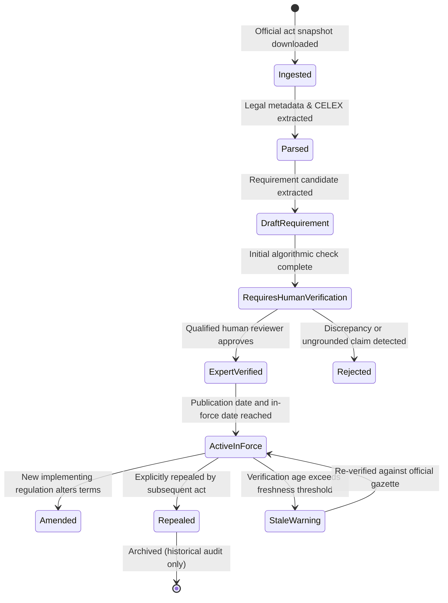

# ReguLens — Regulatory Data Policy & Source Management

## Document Status
- **Current Phase:** Phase 0B — Technical Architecture & MVP Definition
- **Scope:** Complete regulatory source hierarchy, verification lifecycle, data licensing rules, and freshness monitoring
- **Constitutional Principle:** Truth in Sources (`AGENTS.md` Rules 1, 2, 3, 4, 9, 10, 12)

---

## 1. Regulatory Source Authority Hierarchy

ReguLens strictly classifies all regulatory intelligence sources into four authoritative tiers. Only official government or treaty records can serve as the legal foundation for a requirement.

```mermaid
graph TD
    Tier1["Tier 1: Primary Official Legislation & Treaties<br>(Official Journal of the EU, EUR-Lex, Egyptian Official Gazette)"]
    Tier2["Tier 2: Official Operational Databases & Implementing Portals<br>(TRACES NT, EU Pesticides Database, CAPQ Official Circulars)"]
    Tier3["Tier 3: Standardisation References & Administrative Guidelines<br>(CEN/CENELEC OJ Notices, European Commission Guidance Notes)"]
    Tier4["Tier 4: Secondary & Commercial Summaries<br>(Trade association briefs, export council slides, commercial blogs)"]

    Tier1 -->|Authoritative Legal Basis| Rules["ReguLens Regulatory Engine"]
    Tier2 -->|Operational & Technical Thresholds| Rules
    Tier3 -->|Metadata Reference Only (No Full Text)| Rules
    Tier4 -.->|PROHIBITED as Legal Source| Rejected["Rejected / Unverified"]

    style Tier1 fill:#d4edda,stroke:#28a745
    style Tier2 fill:#d1ecf1,stroke:#17a2b8
    style Tier3 fill:#fff3cd,stroke:#ffc107
    style Tier4 fill:#f8d7da,stroke:#dc3545
```

### Tier Descriptions & Usage Rules

1. **Tier 1: Primary Official Legislation & Treaties (Authoritative)**
   - *Sources:* Official Journal of the European Union (OJEU via EUR-Lex), Decisions of the EU-Egypt Association Council, Egyptian Official Gazette (*Al-Waqa'i' al-Misriyya*).
   - *Role:* Establishes binding legal obligations, direct applicability, entry-into-force dates, and formal documentary mandates (e.g. Regulation (EU) 2016/2031, Regulation (EU) 2019/1793 as amended by Regulation (EU) 2026/194, Decision No 1/2024).
   - *System Storage:* Full HTML/XML snapshot, SHA-256 cryptographic checksum, ELI/CELEX permalink, and verbatim article excerpts.

2. **Tier 2: Official Operational Databases & Implementing Portals (Authoritative)**
   - *Sources:* European Commission EU Pesticides Database (official MRL queries), TRACES NT portal specifications, Egypt Central Administration of Plant Quarantine (CAPQ) published mandates.
   - *Role:* Provides exact numerical thresholds (MRL mg/kg limits per active substance) and operational border control post procedures.
   - *System Storage:* Structured tabular data with query timestamp, official API or portal URL, and snapshot of official export.

3. **Tier 3: Technical Standards & Administrative Guidelines (Referential Only)**
   - *Sources:* References to European Standards published in the Official Journal (e.g. EN 14682:2014 cited in Commission Implementing Decision (EU) 2026/901 under GPSR), Commission Notice guidance documents.
   - *Role:* Establishes legal presumptions of conformity under applicable regulations.
   - *System Storage:* **Metadata ONLY** (standard reference code, title, OJ publication reference, date of legal effect). **Proprietary standard texts from CEN/CENELEC/ISO are strictly NEVER stored or redistributed.**

4. **Tier 4: Secondary & Commercial Summaries (Strictly Prohibited as Sources)**
   - *Sources:* Freight forwarder blog posts, trade chamber PowerPoint presentations, news articles, third-party compliance blogs.
   - *Role:* May provide research context for developers, but **NEVER serve as the source of truth for any requirement in ReguLens**.

---

## 2. Regulatory Verification & Lifecycle Workflow

Every regulatory act and requirement recorded in the system undergoes a structured, auditable lifecycle:



### Lifecycle States Defined
- `PROPOSED`: Draft legislation published in official consultation portals. **Per `AGENTS.md` Rule 3, proposed regulations are NEVER presented as active law and carry a prominent yellow tag: "Proposed Draft — Not in Force".**
- `IN_FORCE`: Act has been published in the Official Journal and its application date has arrived. Enforceable by customs and border inspection authorities.
- `AMENDED`: Base regulation remains in force but specific articles, annexes, or check frequencies have been replaced (e.g. Regulation 2019/1793 amended by Regulation 2026/194). The system links both the base act and the amending act.
- `REPEALED`: Act has been superseded and is no longer legally binding. Retained in database strictly for historical audit of past consignments.

---

## 3. Source Freshness & Stale Sync Warning Policy

Per `AGENTS.md` Rule 4:
> "A failed or stale source sync is a visible warning, never a clean-looking result."

Regulatory requirements change rapidly, particularly emergency measures (Annex I of Regulation 2019/1793 is reviewed every 6 months).

### Freshness Thresholds

| Regulatory Category | Maximum Freshness Window | Automated Sync Frequency | Action Upon Threshold Expiry |
|---|---|---|---|
| **Emergency Measures & Enhanced Controls** (e.g. Reg 2019/1793 Annex I) | **30 Calendar Days** | Weekly automated check of EUR-Lex CELEX feed | Trigger `STALE_SOURCE_ALERT`; render visible warning banner on UI and PDF reports. |
| **Pesticide MRLs** (Regulation 396/2005) | **30 Calendar Days** | Bi-weekly query against EU Pesticides Database | Flag unverified active substances with `MRL_UPDATE_PENDING`. |
| **Base Phytosanitary & Customs Regulations** (e.g. Reg 2016/2031, Decision 1/2024) | **90 Calendar Days** | Monthly EUR-Lex status check | Display status note: "Last verified [Date]". |

### Stale Warning Display Protocol
If `CURRENT_TIMESTAMP - regulatory_act.last_verified_at > freshness_window`:
1. The requirement card in the web UI displays an amber warning banner:
   > ⚠️ **Verification Warning:** This regulatory requirement was last verified on `[Date]`. An automated sync update is currently pending. Please verify current status directly at the official source: `[EUR-Lex Link]`.
2. The generated PDF export dossier includes an explicit notice in the Executive Summary and Traceability Matrix.
3. A failed sync event is logged in `audit_logs` with the HTTP status code or connection error.

---

## 4. Regulatory Data Licensing & Intellectual Property Boundaries

*Draft, requires qualified legal review (per `AGENTS.md` Rule 14).*

1. **European Union Official Legislation:**
   - Ingested and reproduced under European Commission Decision 2011/833/EU on the reuse of Commission documents.
   - Commercial reuse is permitted provided:
     - The source is acknowledged (`EUR-Lex, © European Union, https://eur-lex.europa.eu`).
     - The original meaning or message of the documents is not distorted.
     - The European Union is stated as not endorsing the software.
2. **Harmonised Standards (CEN / CENELEC / ISO):**
   - Standards referenced under GPSR or EU Directives are strictly copyrighted by CEN, CENELEC, and national standardization bodies.
   - **ReguLens Policy:**
     - We store and display ONLY bibliographic metadata (Standard Code, Title, OJ publication reference, effective date).
     - We **NEVER** scrape, parse, store, or redistribute the proprietary text, diagrams, or clauses of CEN/CENELEC standards.
     - Users needing the full standard are provided direct links to national standardization distributors (e.g., EOS in Egypt, DIN, AFNOR).
3. **Bilingual Translations:**
   - Authoritative legal text is always preserved in its official gazette language (English).
   - Informational Arabic translations are machine-assisted and explicitly labeled:
     > *"الترجمة العربية استرشادية فقط؛ النص القانوني المعتمد هو النص الصادر في الجريدة الرسمية للاتحاد الأوروبي."*

---

## 5. Source Registry Honesty & Missing Source Handling

Per `AGENTS.md` Rule 9:
> "No claimed integration that does not exist. The source registry reports honest status: Integrated / Partial / Manual only / Not supported."

| Source System | Current Integration Status | Technical Implementation in Slice |
|---|---|---|
| **EUR-Lex (EU Legislation)** | **Partial** | Curated official HTML snapshots stored locally with SHA-256 hashes; manual and scheduled HTTP head checks. Direct REST API integration deferred to Phase 3. |
| **EU Pesticides Database** | **Partial** | Curated MRL reference tables for *Citrus sinensis* exported from official database; direct query pipeline scheduled. |
| **TRACES NT** | **Manual only** | ReguLens provides procedural guidance and CHED-PP/CHED-D requirement checklists; zero automated API integration exists. |
| **CAPQ (Egypt Plant Quarantine)** | **Manual only** | Official ministerial decrees and circulars archived as curated records. No public API exists. |
| **Egypt Customs Authority (Nafeza)** | **Not supported** | Out of scope for Slice. |

### Handling Missing or Unavailable Sources
If a regulatory source cannot be opened, is paywalled, or returns a 404/500 error during research or verification:
1. Per `AGENTS.md` Rule 1, write **"not found"** or **"unknown"**.
2. Never invent regulations, article numbers, or check percentages.
3. The requirement must be marked `STATUS_UNRESOLVED` and placed in `docs/OPEN_QUESTIONS.md`.
