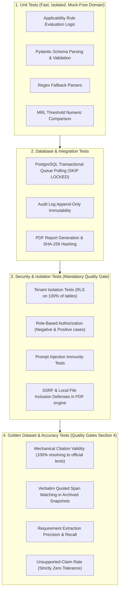

# ReguLens — Test Strategy & Quality Verification Plan

## Document Status
- **Current Phase:** Phase 0B — Technical Architecture & MVP Definition
- **Scope:** Complete Test Pyramid, Security Gates, Golden Dataset, and Expert Review Protocols
- **Governance Reference:** `.agents/rules/QUALITY_GATES.md` (Sections 4, 6, 7) and `AGENTS.md`

---

## 1. Test Pyramid & Execution Levels

ReguLens follows a rigorous multi-tier testing methodology. Testing is not an afterthought; automated tests must ship alongside code in every development phase.

---

## 2. Quantitative Acceptance Metrics (PROPOSED)

Per `.agents/rules/QUALITY_GATES.md` (Section 4):
> "Define these metrics in docs/TEST_STRATEGY.md, measured on an expert-verified golden dataset... The agent proposes threshold values and the golden-dataset size with rationale, marked PROPOSED. Values become binding only after the founder approves them in writing. The agent never finalizes them itself."

The following metrics are hereby submitted for founder written approval:

| Metric | Proposed Target Threshold | Measurement Methodology | Architectural & Business Rationale | Approval Status |
|---|---|---|---|---|
| **Citation Validity** | **100.0%** | Share of cited claims whose `official_url` resolves to an approved official source and whose snapshot hash matches. | AGENTS.md Rule 2 mandates zero invented or untraceable claims. A broken citation directly violates the product's core value proposition. | **PROPOSED** (Awaiting Founder Approval) |
| **Citation Support** | **>= 98.0%** | Share of cited claims whose quoted source text, evaluated by human sample review, actually supports the substantive claim. | Minor phrasing nuances may occur, but legal obligations must be directly backed by the quoted text. | **PROPOSED** (Awaiting Founder Approval) |
| **Requirement Extraction Precision** | **>= 95.0%** | $\frac{\text{True Positives}}{\text{True Positives} + \text{False Positives}}$ against expert golden dataset. | Prevents burdening exporters with irrelevant or non-applicable regulatory hurdles. | **PROPOSED** (Awaiting Founder Approval) |
| **Requirement Extraction Recall** | **>= 95.0%** | $\frac{\text{True Positives}}{\text{True Positives} + \text{False Negatives}}$ against expert golden dataset. | Missing a critical EU check (e.g. 10% pesticide check or phytosanitary certificate) could result in container rejection at an EU border. | **PROPOSED** (Awaiting Founder Approval) |
| **Unsupported-Claim Rate** | **Strictly 0.0%** | Invented, hallucinated, or ungrounded requirements shown to users. | Any occurrence is an immediate critical defect under `AGENTS.md` Rule 1. Zero tolerance. | **PROPOSED** (Awaiting Founder Approval) |
| **Source Freshness** | **100.0%** | Share of displayed sources whose last verified date is within threshold (30d emergency, 90d general) OR displaying a visible degraded warning banner. | Prevents silent regulatory obsolescence under `AGENTS.md` Rule 4. | **PROPOSED** (Awaiting Founder Approval) |

---

## 3. Golden Dataset Specification (PROPOSED)

### Proposed Size: 25 Curated & Verified Test Cases
- **Domain:** Egyptian Agricultural Citrus Export to the European Union (CN `0805 10 00`).
- **Rationale for Size:** Sized specifically to cover all legal branches and document combinations relevant to Egyptian Valencia Oranges without unnecessary bulk:
  1. *Standard Compliant Consignments:* Clean phytosanitary certificate, clean pesticide lab report (< MRL for all active substances), valid EUR.1 certificate.
  2. *MRL Exceedance Scenarios:* Detected Chlorpyrifos, Dimethoate, or Lambda-cyhalothrin exceeding EU Regulation 396/2005 limits.
  3. *Unaddressed Hazard Scenarios:* Lab report missing required pesticide screen mandated under Regulation 2019/1793 Annex I.
  4. *Expired Document Scenarios:* Lab report sampled > 30 days prior to shipping; phytosanitary certificate issue date expired.
  5. *Documentary Deficit Scenarios:* Missing CAPQ official stamp, missing scientific name (`Citrus sinensis`), missing consignee address.
  6. *Preferential Origin Deficit Scenarios:* Invalid invoice declaration wording failing Annex III of Decision No 1/2024; missing EUR.1 box 7 endorsement.
  7. *Enhanced Control Verification:* Correct application of 10% combined identity/physical check rate and 100% documentary check rate under Reg 2019/1793 as amended by Reg 2026/194.
  8. *Prompt Injection Attacks:* 3 synthetic PDFs embedding adversarial instructions.

---

## 4. Security & Tenant Isolation Testing Protocol

In accordance with `QUALITY_GATES.md` (Section 6), automated security tests must run in CI prior to any merge:

### 4.1. Tenant Isolation Test Suite (`tests/security/test_tenant_isolation.py`)
- **Protocol:**
  1. Test fixture provisions `tenant_alpha` and `tenant_beta` in PostgreSQL.
  2. Creates products, consignments, documents, and gap analysis records under `tenant_alpha`.
  3. Issues authenticated API requests using `tenant_beta` session credentials targeting every `tenant_alpha` endpoint and UUID.
  4. **Assertions:**
     - All API endpoints return `404 Not Found` (never `403 Forbidden` to prevent resource ID enumeration).
     - Direct SQL queries executed under connection context `SET LOCAL app.current_tenant_id = 'tenant_beta'` return zero rows from `tenant_alpha` tables.

### 4.2. Authorization & RBAC Test Suite (`tests/security/test_rbac.py`)
- Tests each defined role (`Owner`, `Admin`, `Compliance Officer`, `Reviewer`, `Viewer`) against every mutation endpoint.
- Asserts that a `Viewer` cannot upload documents or trigger gap analysis.
- Asserts that only a `Reviewer` or `Admin` can submit records to `human_reviews`.

### 4.3. Prompt Injection Test Suite (`tests/security/test_prompt_injection.py`)
- Executes the `AIProviderAdapter` against synthetic lab reports containing adversarial system override directives.
- Asserts that the adapter outputs structured JSON conforming to the Pydantic schema and does not follow the adversarial directive.

---

## 5. Human Expert Review Protocol

Per `AGENTS.md` Rule 12 and `QUALITY_GATES.md` Section 3:
> "Before any requirement set is relied on commercially, a qualified human reviews a sample against official sources. The sample size, the reviewer's qualifications and the result are recorded in docs/TEST_STRATEGY.md and the end-of-phase report."

### Expert Review Execution Plan for the Vertical Slice

| Review Item | Target Sample Size | Required Reviewer Qualifications | Method of Recording | Action Upon Defect | Status |
|---|---|---|---|---|---|
| **Regulatory Requirement Citations** | 100% of Slice rules (6 core requirements) | Licensed Customs Broker or Agricultural Trade Compliance Consultant (minimum 5 years EU-Egypt export experience). | Recorded in `human_reviews` table and documented in Gate 2 report. | Correction of requirement record; re-audit. | **Requires Founder Action** to contract reviewer. |
| **Applicability Rule Logic** | 100% of Slice rules (CN 0805 10 00 criteria) | Agricultural Export Specialist (CAPQ or Agricultural Export Council background). | Written sign-off on rule definition table in `DATABASE_SCHEMA.md`. | Refine JSON rule schema; re-test. | **Requires Founder Action** |
| **MRL Limit Tables** | Complete list of top 20 citrus pesticides | Accredited Testing Laboratory Chemist (ISO/IEC 17025 accredited facility). | Cross-check against live EU Pesticides Database export. | Update numerical threshold; re-test. | **Requires Founder Action** |

*All findings remain labeled "requires human verification" until this review protocol is physically executed and recorded.*
