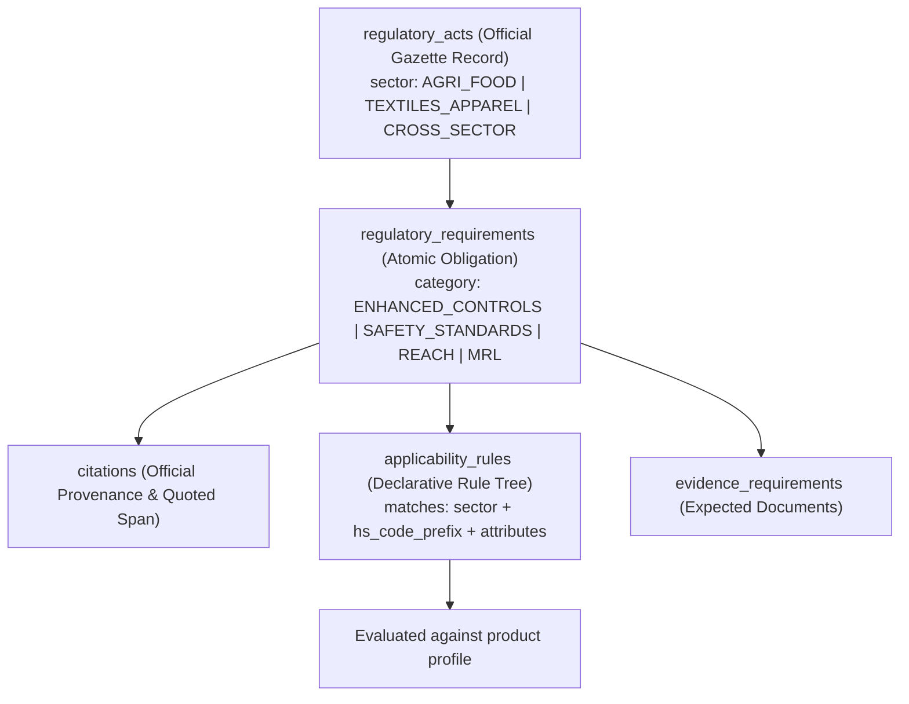

# ADR 0003: Regulatory Data Model, Citation Traceability, and Multi-Sector Applicability

## Status
Approved (Architecture Decision for Phase 1 / Phase 2)

## Date
2026-11-07

## Context
ReguLens provides regulatory intelligence and export-readiness assistance. Per `AGENTS.md`:
- **Rule 1:** No invented laws, requirements, dates, certificate numbers, or HS codes.
- **Rule 2:** Every regulatory claim shown to a user carries a citation to an official source record (URL, authority, reference, last-verified date).
- **Rule 3:** Proposed or draft regulations are never presented as active law. Lifecycle state is always visible.
- **Rule 5:** LLM output is never the source of truth. Applicability comes from structured data and deterministic rules validated against citations.
- **Rule 10:** Machine translation is never the authoritative legal text. Keep original and translation separate with provenance.

Furthermore, ReguLens is a **multi-sector platform** whose strategic scope encompasses:
- **Sector 1 (Agriculture and Agri-food):** Fresh Egyptian oranges, fresh strawberries, frozen strawberries, fresh vegetables, processed food.
- **Sector 2 (Textiles and Apparel):** Ready-made garments, children's clothing, fabrics, home textiles.

The architecture, product catalog, regulatory model, and applicability engine must support both sectors cleanly without hardcoding agricultural assumptions into the shared platform foundations. Fresh Egyptian Valencia Oranges (CN `0805 10 00`) serves as a provisional engineering test case for the first vertical slice, not a permanent product constraint.

## Options Considered

### Option 1: Hardcoded Sector Rule Functions
- Write separate hardcoded Python functions for agriculture and apparel.
- *Pros:* Quick prototype for oranges.
- *Cons:* Locks business logic in code; non-engineering experts cannot review or update rules; tightly couples the engine to specific commodities.

### Option 2: Pure LLM Prompt-Based Extraction & Applicability
- Pass product description to an LLM prompt to guess applicable rules.
- *Pros:* Broad coverage on messy descriptions.
- *Cons:* Directly violates Rule 5 of `AGENTS.md`. Generative models hallucinate laws, confuse check rates, and produce non-deterministic results.

### Option 3: Declarative Relational Multi-Sector Regulatory Model with Deterministic Rule Engine (Approved)
- Model legal acts, requirements, official citations, and applicability rules as relational database entities.
- Support sector-specific categories on top of shared core tables:
  - Agri-food categories: `ENHANCED_OFFICIAL_CONTROLS`, `PLANT_HEALTH`, `MRL_LIMITS`, `FOOD_SAFETY`.
  - Textile categories: `SAFETY_STANDARDS` (e.g. EN 14682), `TEXTILE_LABELLING`, `CHEMICAL_RESTRICTIONS_REACH`, `FLAMMABILITY`.
  - Cross-sector categories: `PREFERENTIAL_ORIGIN`, `GENERAL_PRODUCT_SAFETY`.
- Evaluate applicability deterministically via declarative condition trees matching HS code prefixes, country of origin, destination market, and structured product attributes.
- LLMs are restricted strictly to unstructured text extraction from uploaded PDFs and generating plain-language explanatory summaries.

## Decision
Adopt **Option 3 (Declarative Relational Multi-Sector Regulatory Model with Deterministic Rule Engine)**:

### 1. Multi-Sector Entity Architecture

### 2. Legal Evidence Precision & Safeguards
1. **Enhanced Official Controls vs. Pesticide MRLs:**
   - Regulation (EU) 2026/194 amends Regulation (EU) 2019/1793 Annex I by setting a **10% combined identity and physical check frequency for Egyptian oranges** and **20% for strawberries**.
   - **Crucial Distinction:** Regulation (EU) 2026/194 modifies enhanced official inspection frequencies; it does **NOT** alter pesticide Maximum Residue Limits (MRLs). MRLs are established by Regulation (EC) No 396/2005. The data model records these as separate acts and requirements.
2. **Documentary Checks:**
   - The 100% documentary check rate is derived from Regulation (EU) 2017/625 Article 54(1) and is recorded as provisional, pending validation against an archived primary text snapshot.
3. **TRACES Portals (CHED-PP vs. CHED-D):**
   - The system models CHED-PP (plant health under Reg 2016/2031) and CHED-D (food safety enhanced controls under Reg 2019/1793) as two separate evidence requirements, avoiding any assumption that one replaces the other until confirmed by human expert operational review.
4. **Textile Harmonised Standards (EN 14682:2014 under GPSR):**
   - Listed in Annex I, Entry 37 of Commission Implementing Decision (EU) 2026/901.
   - Provides a presumption of safety under Article 7(1)(a) GPSR strictly for cords and drawstrings in children's clothing.
   - Recorded as referential metadata only; full text is never stored or redistributed.

### 3. Mechanical Definition of "Citation Validated"
Per `QUALITY_GATES.md` (Section 4), a requirement is defined as **Citation Validated** if and only if:
1. `citation.official_url` resolves to an approved official source domain (e.g. `eur-lex.europa.eu`).
2. `citation.source_snapshot_hash` matches the cryptographic SHA-256 hash of the archived official HTML/PDF file stored in the local repository.
3. `citation.quoted_excerpt` exists verbatim (case-sensitive substring match) within the archived source snapshot at the recorded reference location.
4. `regulatory_act.last_verified_at` is within the freshness threshold defined in `REGULATORY_DATA_POLICY.md` (e.g. <= 30 days for emergency measures; <= 90 days for general regulations).

## Consequences
- **Positive:**
  - Full multi-sector extensibility: supports fresh fruit, frozen fruit, apparel, and future industrial sectors.
  - 100% deterministic rule matching; zero risk of LLM hallucinations dictating legal export rules.
  - Strict compliance with `AGENTS.md` Rules 1, 2, 3, 5, and 10.
  - Complete separation of inspection frequencies (Reg 2019/1793 / 2026/194) from MRL limits (Reg 396/2005).
- **Negative / Trade-offs:**
  - Initial requirement authoring and rule curation require manual expert data entry or supervised human-in-the-loop ingestion.

## Reversal Path
Declarative rule trees can be evaluated using standard SQL/JSON queries or exported to a rule engine (e.g., JSONLogic) without modifying the underlying database citation model.
