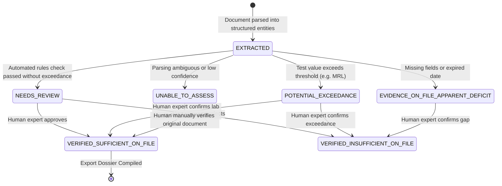

# ADR 0004: Document Evidence, Gap Analysis, and Review State Machine (Multi-Sector Corrected)

## Status
Approved (Architecture Decision for Phase 1 / Phase 2)

## Date
2026-11-07

## Context
ReguLens assists exporters with document verification and gap identification across both agriculture and apparel. Per `AGENTS.md` (Constitutional Preamble):
> "ReguLens is NOT a government authority, certification body, customs authority, law firm or accredited laboratory, and it never guarantees market access. It never states that a product 'is compliant'. It states what cited sources require and what evidence is on file.
> 
> Identifying a requirement, identifying its documents, checking a document exists, judging whether evidence looks sufficient, and establishing legal compliance are five different things. Never present them as equivalent."

Furthermore, Rule 12 specifies:
> "Regulatory correctness cannot be established by the agent. Requirements, applicability rules and classifications must be reviewed by a qualified human (export, customs or regulatory-compliance expert) on a sample before any commercial reliance. Until then they are labeled 'requires human verification'."

We must establish a strict, unambiguous state machine that separates:
1. **Requirement Identification** (What the law says)
2. **Document Identification** (Which document types are customarily associated with the requirement)
3. **Document Presence** (Whether a file has been uploaded and parsed)
4. **Automated Evidence Sufficiency Assessment** (Whether extracted data appears on inspection to meet required parameters)
5. **Human Expert Verification** (Whether a human customs/regulatory specialist has confirmed the match)
6. **Legal Compliance** (AN OUT-OF-BOUNDS STATE THAT REGULENS NEVER ASSERTS)

## Options Considered

### Option 1: Binary "Compliant / Non-Compliant" Status
- The system checks whether documents are uploaded and displays a green "Compliant" badge or red "Non-Compliant" badge.
- *Pros:* Simple UI.
- *Cons:* Strictly forbidden by `AGENTS.md`. Gives false legal assurance, creates extreme product liability, conflates document presence with legal conformity, and misleads exporters into believing government clearance is guaranteed.

### Option 2: Pure Free-Text AI Assessment
- An LLM reads the uploaded document and outputs a conversational paragraph about whether the document satisfies the requirement.
- *Pros:* Handles messy document formats.
- *Cons:* Unstructured, untestable, prone to hallucination, difficult to track across export revisions, impossible to verify deterministically against acceptance criteria.

### Option 3: Formal Multi-Tier Evidence State Machine with Explicit States (Approved)
- Model every document-requirement association through an explicit, auditable state machine with distinct evaluation phases:
  - Extracted Information (`EXTRACTED`)
  - Automated Assessment (`NEEDS_REVIEW`, `POTENTIAL_EXCEEDANCE`, `EVIDENCE_ON_FILE_APPARENT_MATCH`, `EVIDENCE_ON_FILE_APPARENT_DEFICIT`, `UNABLE_TO_ASSESS`)
  - Human Expert Verification (`VERIFIED_SUFFICIENT_ON_FILE`, `VERIFIED_INSUFFICIENT_ON_FILE`, `REJECTED_DISCREPANCY`)

## Decision
Adopt **Option 3 (Formal Multi-Tier Evidence State Machine with Explicit States)**:

### 1. Explicit States by Evaluation Phase

| Evaluation Phase | Concept | Allowed State Enum | Meaning / Operational Behavior |
|---|---|---|---|
| **Phase A: Extraction** | Text Parsing & Entity Extraction | `EXTRACTED` | Raw text or numeric entities extracted from PDF by parser/AI adapter. Treated as unverified data. |
| | | `FAILED` | Text extraction failed (corrupted or unreadable file). |
| **Phase B: Automated Comparison** | Deterministic Assessment | `NEEDS_REVIEW` | Required fields present; automated preliminary matching completed; awaiting human sign-off. |
| | | `POTENTIAL_EXCEEDANCE` | Extracted numeric test value exceeds legal threshold (e.g. detected pesticide > MRL or cord length > standard limit). **Presented as an assessment requiring verification, NOT a final legal judgment.** |
| | | `EVIDENCE_ON_FILE_APPARENT_DEFICIT` | Missing mandatory field, unaddressed hazard, or expired document date. |
| | | `UNABLE_TO_ASSESS` | Document text ambiguous, corrupted, or missing required entity keys. |
| **Phase C: Human Verification** | Expert Review Protocol | `VERIFIED_SUFFICIENT_ON_FILE` | Qualified human reviewer inspected evidence excerpt and approved sufficiency on file. |
| | | `VERIFIED_INSUFFICIENT_ON_FILE` | Qualified human reviewer rejected evidence sufficiency; flags remediation item. |
| | | `REJECTED_DISCREPANCY` | Human reviewer detected fraudulent, altered, or mismatched document details. |
| **Phase D: Legal Compliance** | Customs / Legal Validity | **STRICTLY NEVER GENERATED** | Conceptually rejected. Replaced by "Documented Evidence Ready for Official Submission". |

### 2. State Machine Transitions

### 3. Separation of Concerns
1. **Extracted Information:** Raw output from `pdfplumber` or `AIProviderAdapter` (e.g. `Chlorpyrifos = 0.03 mg/kg` or `Drawstring length = 85mm`).
2. **Deterministic Comparison:** Pure Python/SQL evaluation comparing extracted values against threshold tables (e.g. comparing `0.03` against Regulation 396/2005 MRL of `0.01`). The engine transitions state to `POTENTIAL_EXCEEDANCE`.
3. **Human Expert Verification:** A human reviewer confirms whether the test method was accredited, whether sampling was representative, or whether a re-test is required.
4. **AI Boundary:** The AI model is NEVER allowed to set the verification verdict or determine legal compliance.

### 4. Allowed and Forbidden Verbiage

- **Strictly Forbidden Terms in UI, API, and Reports:**
  - ❌ "Product is compliant"
  - ❌ "Shipment approved"
  - ❌ "Certified for export"
  - ❌ "Customs clearance guaranteed"
  - ❌ "Zero regulatory risk"

- **Mandatory Required UI Terminology:**
  - ✅ "Evidence on file matches cited requirement"
  - ✅ "Potential exceedance detected: [substance/measure] requires verification"
  - ✅ "Missing required evidence on file"
  - ✅ "Document expired on [date]"
  - ✅ "Status: Requires human verification"
  - ✅ "Report status: Preliminary compliance research"

## Consequences
- **Positive:**
  - Absolute protection against deceptive compliance claims.
  - Complete adherence to `AGENTS.md` and regulatory liability principles.
  - Clear separation between automated detection and human judgment.
- **Negative / Trade-offs:**
  - Exporters must be guided by UI copy explaining why potential exceedances are assessments requiring professional follow-up.

## Reversal Path
This state machine is fundamental to ReguLens and cannot be collapsed into binary compliance flags.
