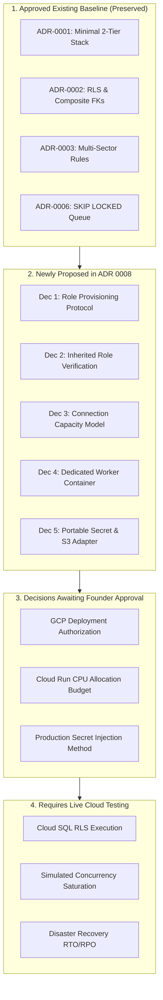

# ADR 0008: GCP Compatibility & Security Preservation
*(Formally accepted on 2026-11-09; provisionally tracked as ADR-002 during review)*

## Status
`ACCEPTED — Formally Approved by Founder (2026-11-09)`

> [!IMPORTANT]
> **Governance Notice:** Formal approval of this ADR establishes the accepted architectural compatibility and security baseline for Google Cloud Platform. However, this approval does **NOT** constitute authorization for live cloud deployment, cloud resource provisioning, billing commitments, or Phase 2 implementation. Cloud SQL managed runtime behavior and IAM Database Authentication compatibility with asyncpg remain explicitly **UNRESOLVED** pending future empirical validation on a provisioned staging environment under Gate 1.

## Date
2026-11-07 (Accepted: 2026-11-09)

---

## 1. ADR Identifier & Numbering Resolution

An ADR numbering collision was identified during the initial review:
- The existing repository sequence in `docs/adr/` contains seven established, approved Architecture Decision Records:
  - `0001-minimal-technology-stack.md`
  - `0002-multi-tenant-isolation-and-rls.md`
  - `0003-regulatory-data-model-and-applicability.md`
  - `0004-document-evidence-and-review-state-machine.md`
  - `0005-ai-integration-boundary-and-degradation.md`
  - `0006-minimal-background-jobs-without-distributed-queues.md`
  - `0007-regulatory-data-licensing-and-storage.md`
- The identifier "ADR-002" collides directly with approved [`docs/adr/0002-multi-tenant-isolation-and-rls.md`](file:///c:/Users/same/Desktop/REGULENS/docs/adr/0002-multi-tenant-isolation-and-rls.md), and the uppercase naming convention diverges from the project constitution (`AGENTS.md` line 40: `docs/adr/NNNN-title.md`).
- **Resolution:**
  1. The canonical unique sequential identifier for this decision is **ADR 0008**.
  2. The canonical filename formally approved by the founder is:  
     `docs/adr/0008-gcp-compatibility-and-security-preservation.md`
  3. Existing ADRs 0001 through 0007 remain completely unmodified, unrenumbered, and in full force.

---

## 2. Context & Problem Statement

ReguLens Phase 1.1.1 established the minimal technical foundation (baseline commit `7ca30ba`), enforcing multi-sector support (agriculture/citrus and textiles/apparel), strict tenant isolation via defense-in-depth (composite keys, application context, and PostgreSQL 16 Row Level Security), fail-closed runtime database role verification, and append-only audit logging.

Google Cloud Platform (GCP) has been designated by the founder as the approved initial cloud hosting direction (specifically Cloud SQL for PostgreSQL, Cloud Run, Secret Manager, Cloud Storage, and GitHub Actions CI/CD).

A targeted GCP Compatibility Audit identified six core areas where managed cloud infrastructure characteristics interact with ReguLens's security and architectural baseline:
1. **Cloud SQL Role Privilege Boundaries:** Cloud SQL customer administrative accounts (e.g. `postgres`) belong to the managed `cloudsqlsuperuser` group and do not possess native PostgreSQL superuser privileges (`rolsuper=false`). Consequently, commands requiring true superuser rights—such as explicit `ALTER ROLE ... NOBYPASSRLS` or cross-role `ALTER DATABASE ... OWNER TO` without prior role membership—fail on Cloud SQL.
2. **Runtime Privilege Introspection Gaps:** The Phase 1.1.1 role verifier inspects direct role attributes (`rolsuper`, `rolbypassrls`), but does not verify inherited group memberships (such as `cloudsqlsuperuser` or `regulens_migrator`), nor does it assert that the runtime role does not own database tables (in PostgreSQL, table owners unconditionally bypass RLS policies unless `FORCE ROW LEVEL SECURITY` applies, and retain DDL capabilities).
3. **Serverless Auto-Scaling & Connection Sizing:** Cloud Run's horizontal auto-scaling combined with client-side connection pooling risks rapid connection exhaustion against Cloud SQL's configured connection ceiling during traffic spikes or revision rollouts.
4. **Serverless CPU Throttling on Task Loops:** Cloud Run's default request-driven CPU throttling freezes in-process polling loops when no HTTP requests are active.
5. **Storage Interoperability Scope:** Documented S3 API compatibility on Google Cloud Storage XML API requires empirical verification against application-specific operations (specifically pre-signed URLs, chunked uploads, and error mapping).
6. **CI/CD Integration Architecture:** Keyless deployment via Workload Identity Federation and containerized CI database testing must be formalized without premature pipeline implementation.

This ADR defines how ReguLens adapts to Google Cloud Platform to achieve production deployment readiness without weakening, bypassing, or silently changing any previously approved architectural, security, governance, or product decisions.

---

## 3. Decision Status & Governance Matrix

To maintain strict alignment with `AGENTS.md` and `.agents/rules/QUALITY_GATES.md`, all architectural elements are categorized into five distinct governance states:



### 3.1. Previously Approved Decisions (Strictly Preserved)
- **ADR-0001 (Minimal Technology Stack):** Two-tier architecture (Next.js frontend, FastAPI backend, PostgreSQL 16 database, private S3-compatible storage). No Redis, no Celery, no vector databases.
- **ADR-0002 (Multi-Tenant Isolation via Defense-in-Depth):** Tenant data isolation enforced across application layer (`set_config('app.current_tenant_id', ...)`), schema layer (composite FKs `(tenant_id, id)`), and database engine layer (`ENABLE ROW LEVEL SECURITY; FORCE ROW LEVEL SECURITY` across 12 customer tables). Runtime role `regulens_app` connects with `NOBYPASSRLS`.
- **ADR-0003 (Regulatory Data Model):** Multi-sector support (agriculture/citrus and textiles/apparel) sharing core platform entities while decoupling sector-specific applicability rules.
- **ADR-0004 & 0005 (Evidence Extraction & AI Boundary):** Structural XML sanitization, strict Pydantic parsing, deterministic fallback, zero tool access for AI models.
- **ADR-0006 (PostgreSQL-Backed Asynchronous Jobs):** Queue implemented via `background_jobs` table using `SELECT ... FOR UPDATE SKIP LOCKED`.
- **Constitutional Guardrails (`AGENTS.md`):** ReguLens is an intelligence assistance tool, not a government certification authority or legal counsel. No mock data outside labeled test environments. Zero secrets in repositories.

---

## 4. Evaluation of GCP Compatibility Audit Findings

Each finding from the preliminary GCP Compatibility Audit has been evaluated independently against official PostgreSQL 16 and Google Cloud technical specifications:

| Audit Finding | Evaluation | Classification & Technical Reality |
|---|---|---|
| **1.1: `NOBYPASSRLS` fails under `cloudsqlsuperuser`** | **VERIFIED** | **[Verified Fact]** In PostgreSQL 16, changing the `BYPASSRLS` attribute via `ALTER ROLE` requires native superuser privileges (`rolsuper=true`). Cloud SQL's administrative account `postgres` belongs to `cloudsqlsuperuser`, which has `rolsuper=false`. Calling `ALTER ROLE regulens_app WITH ... NOBYPASSRLS` raises `ERROR: 42501: must be superuser to change bypassrls attribute`. |
| **1.2: `ALTER DATABASE OWNER` requires role membership and `SET` privilege in PG 16** | **VERIFIED** | **[Verified Fact]** Under PostgreSQL 16 non-superuser semantics, transferring database ownership via `ALTER DATABASE ... OWNER TO <target_role>` requires `CREATEDB` exclusively from the executing role performing the transfer (`postgres`), ownership of the database, and **the ability to `SET ROLE` to the target role**. PostgreSQL 16 documentation does not require `CREATEDB` from the new database owner (`regulens_migrator`), which remains `NOCREATEDB`. In PostgreSQL 16, role creators receive an automatic membership grant `WITH ADMIN TRUE, SET FALSE, INHERIT FALSE`. Because `SET` defaults to `FALSE`, the creator cannot `SET ROLE` to the new role without an explicit `GRANT <target_role> TO <creator> WITH SET TRUE;`. Neither `gcloud sql databases create` nor Terraform `google_sql_database` supports an initial owner flag. |
| **1.3: `psql` meta-commands incompatible with Cloud SQL Studio/drivers** | **VERIFIED** | **[Verified Fact]** Client meta-commands (`\set`, `\gexec`, `\c`) are exclusive to the interactive `psql` terminal. They fail with syntax errors in Cloud SQL Studio (GCP Console) and standard programmatic drivers (JDBC, asyncpg, psycopg). |
| **2.1: Runtime check misses inherited and table-owner roles** | **PARTIALLY VERIFIED** | **[Verified with Correction]** The audit correctly noted that `verify_database_role()` misses inherited roles and table ownership. However, the audit's assertion that `pg_read_all_data` bypasses RLS is **INCORRECT**: per official PostgreSQL documentation, `pg_read_all_data` is subject to RLS policies. Nevertheless, `regulens_app` must be restricted from possessing `pg_read_all_data` (violates least-privilege scoping) and `pg_write_all_data` (violates audit log immutability). Table ownership *does* bypass RLS by default. |
| **2.2: Mandatory role verification in production** | **VERIFIED** | **[Verified Fact]** Implemented and verified in commit `7ca30ba`. `CHECK_DB_ROLE_ON_STARTUP=True` is strictly mandatory in production/staging and fails closed with `DatabaseSecurityError`. |
| **3.1 & 3.2: RLS & Audit Log Immutability on Cloud SQL** | **VERIFIED** | **[Verified Fact]** Cloud SQL provides full PostgreSQL 16 engine feature parity. `FORCE ROW LEVEL SECURITY`, transaction-local `set_config()`, and DDL privilege revocations on `public.audit_logs` operate identically to self-hosted PostgreSQL. |
| **4.1: SQLAlchemy pool sizing exhausts Cloud SQL connections** | **VERIFIED** | **[Verified Fact]** Fixed pool settings (`pool_size=10, max_overflow=20` = 30 connections/container) multiplied by Cloud Run auto-scaling instances (e.g. 10–20 containers) can demand 300–600 connections, exceeding standard Cloud SQL tier limits (100–250). |
| **5.1: In-process task loop stalls under CPU throttling** | **VERIFIED** | **[Verified Fact]** Cloud Run default serverless instances throttle CPU when no inbound HTTP requests are active, causing in-process `asyncio` loops polling `background_jobs` to freeze. |
| **6.1: Secret Manager environment variable injection** | **VERIFIED** | **[Verified Fact]** Secret Manager environment variable mounting conforms to `apps/api/app/core/config.py`. `hide_input_in_errors=True` ensures secrets are never echoed to stdout or structured logs. |
| **6.2: Cloud SQL IAM database authentication** | **UNVERIFIED** | **[Unresolved Technical Question]** IAM database authentication via Cloud SQL Python Connector is a recommended cloud-native pattern, but remains unverified against ReguLens's async SQLAlchemy / asyncpg connection stack. |
| **7.1: Application statelessness on Cloud Run** | **VERIFIED** | **[Verified Fact]** FastAPI backend is completely stateless; JWT sessions and tenant contexts are transaction-bound. |
| **8.1: Storage portability via Cloud Storage S3 Interop** | **PARTIALLY VERIFIED** | **[Documented API Compatibility — Requires Live Validation]** GCS XML API documentation confirms S3 HMAC compatibility, but application compatibility (specifically pre-signed upload URLs and error headers) remains unverified until live integration testing. |
| **9.1: GitHub Actions Workload Identity Federation** | **PARTIALLY VERIFIED** | **[Proposed Architecture — Pending Implementation Authorization]** The architecture is sound and well-documented by Google, but no GitHub Actions workflows currently exist in the repository. |

---

## 5. Detailed Decisions & Technical Investigations

### 5.1. Cloud SQL Role Provisioning & Bootstrap Sequence
* **Classification:** `Proposed Decision — Pending Founder Approval`
* **Technical Investigation & Identity Separation:**
  To prevent privilege leakage, four distinct PostgreSQL role classifications are defined on Cloud SQL:
  1. *Cloud SQL Internal System Roles (`cloudsqladmin`, `cloudsqlagent`):* Managed exclusively by Google for automated backups, replication, and telemetry. Inaccessible to customers.
  2. *Built-in Customer Administrative Role (`postgres`):* Member of `cloudsqlsuperuser`. Possesses `CREATEROLE` and `CREATEDB`, but `rolsuper=false` and `rolbypassrls=false`. It is NOT a native PostgreSQL superuser.
  3. *Schema Migration Owner Role (`regulens_migrator`):* Dedicated DDL account. Owns the database, schemas, tables, and sequences. Does NOT serve application traffic. Adheres strictly to least privilege: does NOT possess `CREATEDB`, `CREATEROLE`, `SUPERUSER`, or `BYPASSRLS`.
  4. *Runtime Application Role (`regulens_app`):* Unprivileged DML account used by FastAPI. Possesses `NOBYPASSRLS`, `NOSUPERUSER`, `NOCREATEDB`, `NOCREATEROLE`, `NOINHERIT`. Must own zero public tables.
* **PostgreSQL 16 Role-Membership Semantics & Ownership Transfer:**
  Because `gcloud sql databases create` and Terraform `google_sql_database` do not support an initial owner parameter, Cloud SQL creates the database under the executing administrator (`postgres`).
  Under PostgreSQL 16 non-superuser rules (`sql-alterdatabase.html`), to execute `ALTER DATABASE regulens_dev OWNER TO regulens_migrator`, the executing user (`postgres`) must:
  1. Own the database (true for `postgres` upon creation).
  2. Possess the `CREATEDB` privilege (true for `postgres`).
  3. **Possess the ability to `SET ROLE` to the target role (`regulens_migrator`).**
  
  In PostgreSQL 16, when a `CREATEROLE` user creates a role, PostgreSQL automatically grants that role back to the creator with:
  `WITH ADMIN TRUE, SET FALSE, INHERIT FALSE`.
  Because `SET` defaults to `FALSE`, the creator cannot `SET ROLE` to the new role. Consequently, running `ALTER DATABASE ... OWNER TO regulens_migrator` without further action will fail.
  However, because `postgres` possesses `ADMIN TRUE` on the role it just created, it has administrative rights to grant the role to itself with `SET TRUE`:
  `GRANT regulens_migrator TO postgres WITH SET TRUE;`.

* **PostgreSQL 16 Grantor Semantics & `pg_auth_members` Catalog Lifecycle:**
  A critical mechanical detail of PostgreSQL 16 role membership must be understood to evaluate the security state after cleanup:
  1. *Catalog Structure:* The `pg_auth_members` catalog tracks role membership with a composite primary key `(roleid, member, grantor)`.
  2. *Automatic Creation Grant:* When `postgres` creates `regulens_migrator`, PostgreSQL records an internal grant with `grantor = BOOTSTRAP_SUPERUSERID` (the internal cluster bootstrap superuser, OID 10):
     `pg_auth_members (roleid: regulens_migrator, member: postgres, grantor: 10, admin_option: true, inherit_option: false, set_option: false)`.
  3. *Explicit Self-Grant:* When `postgres` executes `GRANT regulens_migrator TO postgres WITH SET TRUE;`, PostgreSQL creates a **separate, distinct entry** where `grantor = postgres`:
     `pg_auth_members (roleid: regulens_migrator, member: postgres, grantor: postgres, admin_option: false, inherit_option: false, set_option: true)`.
     This second entry provides the effective capability `set_option = true`, permitting `postgres` to execute `SET ROLE regulens_migrator` and transfer database ownership.
  4. *Effect of Cleanup (`REVOKE`):* When `postgres` subsequently executes `REVOKE regulens_migrator FROM postgres;`, SQL standard authorization rules dictate that a non-superuser can only revoke grants where they are the grantor.
     Therefore, the `REVOKE` command deletes **only** the second entry (`grantor = postgres`).
     The initial bootstrap-granted entry (`grantor = 10`) **remains in `pg_auth_members`** with `admin_option = true, inherit_option = false, set_option = false`.
  5. *Post-Cleanup Authorization State & Verification Query:*
     After the explicit `SET` grant is revoked, the security state of `postgres` with respect to `regulens_migrator` is verified using PostgreSQL's system information function `pg_has_role()`:
     ```sql
     SELECT 
         pg_has_role('postgres', 'regulens_migrator', 'MEMBER') AS is_member,
         pg_has_role('postgres', 'regulens_migrator', 'SET') AS can_set_role,
         pg_has_role('postgres', 'regulens_migrator', 'USAGE') AS inherits_privileges;
     ```
     **Expected Results:**
     - `is_member` (`MEMBER`): **`TRUE`** (because the creator `ADMIN OPTION` record granted by `BOOTSTRAP_SUPERUSERID` persists in `pg_auth_members`).
     - `can_set_role` (`SET`): **`FALSE`** (because the explicit `WITH SET TRUE` grant was revoked; `postgres` cannot execute `SET ROLE regulens_migrator`).
     - `inherits_privileges` (`USAGE`): **`FALSE`** (because `inherit_option` is `FALSE`; `postgres` does not inherit schema, table, or sequence privileges).
     
     *(Note on function arguments: `pg_has_role([user,] role, privilege)` accepts `'MEMBER'`, `'SET'`, and `'USAGE'`. There is no `'INHERIT'` argument in PostgreSQL; role privilege inheritance is evaluated exclusively via `'USAGE'`).*
  6. *Precision Notice:* It is technically inaccurate to describe `REVOKE regulens_migrator FROM postgres;` as "removing all membership" or asserting `MEMBER = FALSE`. `MEMBER` is `TRUE` because administrative membership persists; however, `SET` is `FALSE` and `USAGE` is `FALSE`, completely eliminating operational identity assumption and privilege inheritance.

* **Least-Privilege Role Definition for `regulens_migrator`:**
  - *Privilege Evaluation:* Alembic migrations perform DDL exclusively within the target database `regulens_dev` (creating schemas, tables, indexes, custom types, extensions, and RLS policies). Alembic never creates or drops databases.
  - *Database Ownership vs. `CREATEDB`:* Per official PostgreSQL 16 documentation for `ALTER DATABASE ... OWNER TO`, the `CREATEDB` privilege is required exclusively from the *executing role* performing the ownership transfer (`postgres`), not from the new database owner (`regulens_migrator`). Database ownership does **NOT** require the owner role to possess `CREATEDB`.
  - *Provisioning Model Invariants:*
    - `postgres` executes `ALTER DATABASE` and possesses `CREATEDB`.
    - `regulens_migrator` remains `NOCREATEDB`.
    - `regulens_app` remains `NOCREATEDB`, `NOCREATEROLE`, `NOSUPERUSER`, `NOBYPASSRLS`.
    - No third database-owner role is required or introduced solely to solve this issue.
  - *Attack Surface Reduction:* Granting `CREATEDB` to `regulens_migrator` violates least privilege (`AGENTS.md` Rule 15). If migration credentials leaked, an attacker holding `CREATEDB` could create unmonitored shadow databases, consume provisioned disk quotas, or exhaust connection limits.
  - *Decision:* `regulens_migrator` is defined strictly with `LOGIN` (and `NOCREATEDB`).

* **Proposed Safe Bootstrap Sequence:**
  ```sql
  -- Step 1: Create migration owner role (least-privilege: NO CREATEDB required)
  CREATE ROLE regulens_migrator WITH LOGIN PASSWORD 'MIGRATOR_SECRET';

  -- Step 2: Create runtime application role (defaults to NOSUPERUSER, NOBYPASSRLS, NOCREATEDB)
  CREATE ROLE regulens_app WITH LOGIN PASSWORD 'APP_SECRET';

  -- Step 3: Grant membership WITH SET TRUE for ownership transfer (satisfies PG 16 SET ROLE requirement)
  GRANT regulens_migrator TO postgres WITH SET TRUE;

  -- Step 4: Transfer database ownership safely
  ALTER DATABASE regulens_dev OWNER TO regulens_migrator;

  -- Step 5: Revoke explicit SET grant to remove operational access (leaves non-assumable creator ADMIN OPTION in pg_auth_members)
  REVOKE regulens_migrator FROM postgres;
  ```
* **Privilege Escalation & Security Invariant Analysis:**
  The explicit grant of `regulens_migrator` to `postgres` with `SET TRUE` is temporary, strictly scoped to the provisioning transaction/runbook, and revoked immediately after ownership transfer. Following Step 5, `postgres` retains zero ability to execute `SET ROLE regulens_migrator` or inherit its permissions.
  The runtime role `regulens_app` receives zero administrative attributes, owns zero tables, and is granted only `USAGE` on schema `public` and DML permissions via default privileges. Audit log immutability (`REVOKE UPDATE, DELETE, TRUNCATE ON TABLE public.audit_logs FROM regulens_app`) remains strictly enforced in Alembic migration Section 13.
* **Separation of Provisioning Stages:**
  - *Stage 1 (Cluster & DB Infrastructure):* Terraform or `gcloud` creates the Cloud SQL instance, database `regulens_dev`, and login accounts.
  - *Stage 2 (Database-Scoped Privilege DDL):* Executed directly inside `regulens_dev` (connecting as `postgres` or `regulens_migrator`), setting `public` schema ownership to `regulens_migrator`, granting `USAGE` to `regulens_app`, setting `ALTER DEFAULT PRIVILEGES`, and revoking table truncation.
* **Documented vs. Unverified Live Behavior:**
  - *Documented Engine Behavior:* The `WITH SET TRUE` grant sequence and `pg_auth_members` catalog mechanics conform strictly to official PostgreSQL 16 engine specifications.
  - *Unverified Cloud SQL Behavior:* Whether Google Cloud SQL's managed wrapper or IAM integration allows `postgres` to execute `GRANT ... WITH SET TRUE;` without permission errors has **not** been executed on a live Cloud SQL cluster in this repository.
  - **Explicit Limitation:** Live Cloud SQL compatibility is **NOT** claimed as proven until a real Cloud SQL instance is provisioned and tested under Gate 1.

---

### 5.2. Runtime Privilege Verification Strategy
* **Classification:** `Proposed Decision — Pending Founder Approval`
* **Technical Investigation (Distinction of Privileges):**
  - `rolsuper` & `rolbypassrls`: Native PostgreSQL attributes that globally bypass all RLS policies. Must be verified false.
  - *Table Ownership:* In PostgreSQL, the owner of a table bypasses RLS policies on that table by default (unless `FORCE ROW LEVEL SECURITY` applies) and retains DDL rights (`ALTER TABLE`, `DROP POLICY`, `TRUNCATE`). `regulens_app` must **never** own tables.
  - *Administrative Group Membership:* Membership in `cloudsqlsuperuser` or `regulens_migrator` transfers elevated DDL/ownership powers.
  - *Predefined Roles:*
    - `pg_read_all_data`: Does **not** bypass RLS policies (confirmed via official PostgreSQL specifications), but grants cluster-wide `SELECT` across non-tenant/system tables, violating least-privilege scoping.
    - `pg_write_all_data`: Grants `UPDATE/DELETE/TRUNCATE` cluster-wide, which would directly subvert `audit_logs` immutability.
* **Safe Implementation (Handling Missing Roles):**
  In PostgreSQL, invoking `pg_has_role(current_user, 'cloudsqlsuperuser', 'member')` when `cloudsqlsuperuser` does not exist (e.g. in local development or standard Docker CI) raises a fatal runtime error: `ERROR: role "cloudsqlsuperuser" does not exist`.
* **Proposed Minimum-Privilege Verification Query:**
  The query in `apps/api/app/db/session.py` will safely inspect effective privileges and role memberships by joining `pg_roles` conditionally:
  ```sql
  SELECT 
      r.rolname,
      r.rolsuper,
      r.rolbypassrls,
      -- Check membership in cloudsqlsuperuser ONLY if role exists in cluster
      CASE WHEN EXISTS (SELECT 1 FROM pg_roles WHERE rolname = 'cloudsqlsuperuser')
           THEN pg_has_role(current_user, 'cloudsqlsuperuser', 'member')
           ELSE false END AS is_cloudsqlsuperuser,
      -- Check membership in schema migration owner role
      CASE WHEN EXISTS (SELECT 1 FROM pg_roles WHERE rolname = 'regulens_migrator')
           THEN pg_has_role(current_user, 'regulens_migrator', 'member')
           ELSE false END AS is_migrator,
      -- Check dangerous write-all role
      CASE WHEN EXISTS (SELECT 1 FROM pg_roles WHERE rolname = 'pg_write_all_data')
           THEN pg_has_role(current_user, 'pg_write_all_data', 'member')
           ELSE false END AS is_write_all_data,
      -- Count tables owned by runtime role in public schema (must be exactly 0)
      (SELECT count(*) FROM pg_tables WHERE schemaname = 'public' AND tableowner = current_user) AS owned_tables_count
  FROM pg_roles r
  WHERE r.rolname = current_user;
  ```
  Startup fails closed with `DatabaseSecurityError` if any check fails: `rolname != settings.EXPECTED_DB_RUNTIME_ROLE`, `rolsuper = true`, `rolbypassrls = true`, `is_cloudsqlsuperuser = true`, `is_migrator = true`, `is_write_all_data = true`, or `owned_tables_count > 0`.

---

### 5.3. Cloud Run Connection Capacity Model
* **Classification:** `Proposed Decision — Pending Founder Approval`
* **Important Constraint:** `max_connections` on Cloud SQL is **not a universal constant**. It is determined by the provisioned RAM tier (e.g. typically ~100 on 3.75GB RAM tiers, ~250 on 7.5GB RAM tiers, ~500 on 15GB RAM tiers) and can be modified via Cloud SQL database flags. Connection capacity must be evaluated against the **actual configured `max_connections`** of the specific provisioned tier.
* **Connection Consumer Breakdown (Assumed Design Parameters):**
  1. *Cloud Run API Instances ($C_{api}$):*
     - Normal peak: $N_{max}$ instances.
     - Rolling update burst: Cloud Run can temporarily run up to $2 \times N_{max}$ instances during blue/green revision rollouts.
     - Each instance connection allocation: $P = pool\_size + max\_overflow$.
     - Total API burst connections: $C_{api\_burst} = 2 \times N_{max} \times P$.
  2. *Dedicated Background Worker Service ($C_{worker}$):*
     - Fixed instances: $N_{worker} = 1$ to $2$.
     - Worker pool per instance: $P_{worker} = 3$ (pool=1, overflow=2). Total = $6$.
  3. *Cloud SQL System & Monitoring Connections ($C_{system}$):*
     - Cloud SQL internal agents (`cloudsqlagent`): 3–5 connections.
     - `superuser_reserved_connections`: Cloud SQL reserves 3 slots for admin access. Total = $8$.
  4. *Schema Migration Runner ($C_{migration}$):*
     - Alembic deployment pipeline: 2 connections.
  5. *Administrative / Operator Headroom ($C_{admin}$):*
     - Bastion/developer troubleshooting slots: 5 connections.
* **Proposed Sizing Scenarios (Assumed Models — Subject to Gate 7 Concurrency Testing):**
  
  $$\text{Total Required Slots} = (2 \times N_{max} \times P) + C_{worker} + C_{system} + C_{migration} + C_{admin}$$

  - **Scenario A (Standard Production — Assuming 2 vCPU Tier, 7.5GB RAM, Configured `max_connections = 250`):**
    - Sizing assumption: $P = 2 + 2 = 4$ connections per container.
    - Cloud Run ceiling assumption: $N_{max} = 20$ instances (burst up to 40 during rollout).
    - API connection burst: $40 \times 4 = 160$ connections.
    - Total demand: $160 + 6 + 8 + 2 + 5 = 181$ connections.
    - Headroom: 69 connections ($27.6\%$ safety margin).
  - **Scenario B (Cost-Constrained Staging — Assuming 1 vCPU Tier, 3.75GB RAM, Configured `max_connections = 100`):**
    - Sizing assumption: $P = 1 + 1 = 2$ connections per container.
    - Cloud Run ceiling assumption: $N_{max} = 10$ instances (burst up to 20 during rollout).
    - API connection burst: $20 \times 2 = 40$ connections.
    - Total demand: $40 + 6 + 8 + 2 + 5 = 61$ connections.
    - Headroom: 39 connections ($39\%$ safety margin).
* **Portability Impact:** Database pool parameters (`DB_POOL_SIZE`, `DB_MAX_OVERFLOW`) will be exposed as environment variables in `Settings`, defaulting safely to `pool_size=2, max_overflow=2` in production while preserving `pool_size=10, max_overflow=20` for single-instance local development.

---

### 5.4. Background Worker Architecture & Cost Model
* **Classification:** `Proposed Decision — Pending Founder Approval`
* **Technical Investigation of Cloud Run Execution Semantics:**
  - *Cloud Run Idle Behavior:* Deploying a service with `--no-cpu-throttling` allocates continuous CPU **only while an instance is running**. If `--min-instances 0` is set, Cloud Run will scale the service to zero instances when no HTTP traffic arrives, terminating the in-process worker.
  - *Continuous Polling Requirement:* To guarantee continuous execution of the `background_jobs` polling loop (`SELECT ... FOR UPDATE SKIP LOCKED`), Cloud Run requires:
    `--min-instances 1` **AND** `--no-cpu-throttling`.
  - *Billing Mode:* This configuration engages Cloud Run's **Instance-based pricing model** (billed 24/7 for the allocated compute/memory tier).
* **Worker Compute Cost Arithmetic (Explicit Pricing Model Assumptions):**
  - **Assumed Billing Mode:** Cloud Run Instance-based pricing.
  - **Assumed Region:** `us-central1` (Tier 1 region).
  - **Assumed Resource Sizing:** $0.5$ vCPU ($500\text{m}$) and $512\text{ MiB}$ ($0.5\text{ GiB}$) RAM.
  - **Assumed Minimum Instances:** `min-instances = 1`.
  - **Assumed Duration:** $730\text{ hours/month}$ ($365\text{ days} \times 24\text{ hours} / 12\text{ months} = 730\text{ hours} = 2,628,000\text{ seconds}$).
  - **Official Published Rates (us-central1, 2026):**
    - Compute: $\$0.00002400\text{ per vCPU-second}$.
    - Memory: $\$0.00000250\text{ per GiB-second}$.
  - **Calculation:**
    - vCPU Cost: $0.5\text{ vCPU} \times \$0.00002400 \times 2,628,000\text{ sec} = \$31.536/\text{month}$.
    - Memory Cost: $0.5\text{ GiB} \times \$0.00000250 \times 2,628,000\text{ sec} = \$3.285/\text{month}$.
    - **Total Estimated Worker Compute Cost:** $\approx \$34.82/\text{month}$.
  - *Notice:* This figure covers **compute charges for the worker container only**. It does **NOT** represent the complete infrastructure bill (excludes Cloud SQL instance costs, Cloud Storage storage/egress, networking, and Secret Manager API requests). It is an estimate based on published list prices, not a guaranteed commercial invoice.
* **Architecture Options Compared:**
  1. *Option 1: Dedicated Cloud Run Worker Service (Recommended for Phase 1):*
     - Deploys a separate Cloud Run service (`regulens-worker`) from the same container image with `--min-instances 1` and `--no-cpu-throttling`, executing `python -m app.worker.poller`.
     - *Pros:* 100% preserves ADR-0006 (`SKIP LOCKED`). Zero proprietary cloud dependencies. Completely portable to Docker/VPS. Isolates heavy PDF parsing CPU load from the API.
     - *Cons:* Fixed monthly baseline compute cost ($\approx \$35/\text{month}$).
  2. *Option 2: Cloud Tasks Push Webhooks to API (Scale-to-Zero Alternative):*
     - When a document is uploaded, API enqueues a Cloud Tasks HTTP task that calls an internal API endpoint. Cloud Run scales to zero when idle.
     - *Pros:* Zero baseline cost when idle.
     - *Cons:* Departs from pure ADR-0006 PostgreSQL transactional queue; requires implementing a Cloud Tasks client and managing webhook authorization tokens.
* **Proposed Recommendation:** Adopt Option 1 (Dedicated Worker Service) to preserve strict technology minimalism (ADR-0001) and transactional queue integrity (ADR-0006) without premature cloud-proprietary coupling.

---

### 5.5. Storage Portability & S3 Interoperability
* **Classification:** `Proposed Decision — Pending Founder Approval`
* **Technical Investigation (Documented vs. Tested Compatibility):**
  - *Documented API Coverage:* Google Cloud Storage XML API supports standard S3 REST endpoints (`PutObject`, `GetObject`, `DeleteObject`, `HeadObject`) and supports HMAC key authentication.
  - *Specific Compatibility Risks Requiring Live Testing:*
    1. *Pre-signed URLs:* GCS XML API supports S3 pre-signed URLs, but AWS SigV4 vs SigV2 header formatting, chunked upload headers, and region headers (`us-east-1` vs GCP location) can cause signature validation mismatches.
    2. *Metadata Prefixes:* GCS converts `x-amz-meta-*` headers to `x-goog-meta-*`.
    3. *Error Code Parity:* S3 error responses (`NoSuchKey`, `AccessDenied`) must map consistently in exception handlers.
* **Proposed Action:** Retain the provider-agnostic S3 configuration in `apps/api/app/core/config.py`. Mark GCS storage compatibility as `PROPOSED — Requires Live Validation in Gate 9` (do not claim full compatibility before executing automated pre-signed URL upload/download tests against a live GCS bucket).

---

### 5.6. CI/CD Architecture via GitHub Actions
* **Classification:** `Proposed Architecture — Pending Implementation Authorization`
* **Clarification:** The repository currently contains **zero** GitHub Actions workflow files (`.github/workflows/` does not exist). Workload Identity Federation is a proposed design, not an implemented pipeline.
* **Proposed Workflow Architecture:**
  1. *Authentication:* Keyless OIDC authentication via `google-github-actions/auth`. Zero service account JSON keys stored in repository secrets.
  2. *Automated Testing:* GitHub Actions workflow spins up a native `services: postgres: image: postgres:16` container to execute the full pytest test suite, including the 10 live Row Level Security tests (`tests/security/test_postgres_rls.py`).
  3. *Container Build:* Multi-arch container build pushed to Google Artifact Registry.
  4. *Deployment:* Migration step executed via Cloud SQL Auth Proxy, followed by Cloud Run service deployment.

---

## 6. Testing & Verification Gates Before Production Deployment

Before any production deployment to Google Cloud Platform is authorized by the founder, the following 10 mandatory testing gates must be passed and documented:

| Gate | Verification Area | Target Environment | Acceptance Criteria & Enforcement Mechanism |
|---|---|---|---|
| **Gate 1** | Fresh Database Provisioning | Local PostgreSQL & Cloud SQL | Stage 1 (infrastructure) and Stage 2 (privilege script) execute without errors. Roles `regulens_migrator` (with `NOCREATEDB`) and `regulens_app` exist with correct privileges. Post-cleanup verification query yields `MEMBER = TRUE`, `SET = FALSE`, and `USAGE = FALSE` on `postgres` against `regulens_migrator` (confirming `postgres` retains administrative membership but cannot assume the role or inherit its privileges). |
| **Gate 2** | Runtime Role & Catalog Assertions | API Startup Test | `verify_database_role()` asserts `rolsuper=false`, `rolbypassrls=false`, `owned_tables_count = 0`, and `pg_has_role(...) IS FALSE` for `cloudsqlsuperuser` and `regulens_migrator`. Safe handling on systems where `cloudsqlsuperuser` is absent. |
| **Gate 3** | Cross-Tenant Isolation | Integration Test Suite | Automated tests confirm Tenant A cannot read, insert, update, or delete Tenant B records across products, consignments, documents, and reports. |
| **Gate 4** | PostgreSQL RLS Enforcement | Live PostgreSQL Cluster | All 10 tests in [`tests/security/test_postgres_rls.py`](file:///c:/Users/same/Desktop/REGULENS/tests/security/test_postgres_rls.py) execute under `regulens_app` and transition from `SKIPPED` to `PASSED`. Zero bypasses permitted. |
| **Gate 5** | Audit Log Immutability | Security Test | Attempting `UPDATE`, `DELETE`, or `TRUNCATE` on `public.audit_logs` under `regulens_app` is rejected at both the SQL privilege layer (permission denied) and RLS policy layer. |
| **Gate 6** | Alembic Migration Execution | Staging Database | `alembic upgrade head` runs cleanly under `regulens_migrator`. Table creation, RLS enablement, and Section 13 audit log privilege revocations complete successfully. |
| **Gate 7** | Connection Pool Capacity Under Load | Concurrency Test (Locust) | Simulated concurrent Cloud Run containers execute load test. Total database connections stay strictly below the actual configured `max_connections` ceiling. Zero connection pool timeout errors. |
| **Gate 8** | Background Worker Reliability & Recovery | Worker Integration Test | Worker picks up `DOCUMENT_PARSE` and `REPORT_GENERATE` tasks via `SKIP LOCKED`. Processing failures trigger exponential backoff. Process crash resumes pending jobs cleanly. |
| **Gate 9** | Object Storage Pre-Signed URL Test | Live GCS / S3 Bucket | Automated test uploads and downloads documents using pre-signed URLs generated via S3 XML Interoperability API. Checksum verification and expiration headers validate cleanly. |
| **Gate 10** | Disaster Recovery & Backup Integrity | Cloud SQL Point-in-Time Restore | Automated daily backups and WAL archiving enabled. Test restore to a separate instance validates RPO < 15 minutes and RTO < 60 minutes with full schema and RLS intact. |

---

## 7. Official Documentation References

- **Google Cloud SQL PostgreSQL Users and Roles:**  
  https://cloud.google.com/sql/docs/postgres/users  
  https://cloud.google.com/sql/docs/postgres/create-manage-users
- **Google Cloud SQL PostgreSQL Database Creation:**  
  https://cloud.google.com/sql/docs/postgres/create-manage-databases
- **Google Cloud SQL Connection Limits & Quotas:**  
  https://cloud.google.com/sql/docs/postgres/quotas#fixed-limits
- **Cloud Run CPU Allocation & Pricing:**  
  https://cloud.google.com/run/docs/configuring/cpu-allocation  
  https://cloud.google.com/run/pricing
- **Google Cloud Storage S3 XML Interoperability API:**  
  https://cloud.google.com/storage/docs/interoperability
- **Workload Identity Federation for GitHub Actions:**  
  https://cloud.google.com/iam/docs/workload-identity-federation-with-other-providers
- **PostgreSQL 16 System Information Functions (`pg_has_role`):**  
  https://www.postgresql.org/docs/current/functions-info.html
- **PostgreSQL 16 Predefined Roles:**  
  https://www.postgresql.org/docs/current/predefined-roles.html
- **PostgreSQL 16 Role Attributes (`BYPASSRLS`):**  
  https://www.postgresql.org/docs/current/role-attributes.html
- **PostgreSQL 16 Role Membership & `pg_auth_members` Catalog:**  
  https://www.postgresql.org/docs/16/role-membership.html  
  https://www.postgresql.org/docs/16/catalog-pg-auth-members.html
- **PostgreSQL 16 Client Connection Defaults (`createrole_self_grant`):**  
  https://www.postgresql.org/docs/16/runtime-config-client.html#GUC-CREATEROLE-SELF-GRANT

---

## 8. Consequences & Trade-offs

### Positive Consequences
- **Zero Architectural Degradation:** Multi-sector data modeling, Row Level Security, composite key integrity, and audit log immutability remain 100% intact.
- **Provider Portability Preserved:** No proprietary GCP SDKs are introduced into application code. Storage uses S3 interoperability; task scheduling remains in PostgreSQL; secrets use environment variables.
- **Fail-Closed Protection:** Enhanced database role verification guards against cloud-specific role inheritance and table-ownership RLS bypasses.

### Operational Costs & Constraints
- **Dedicated Worker Compute Cost:** Running a dedicated Cloud Run worker instance with `--min-instances 1` and `--no-cpu-throttling` incurs an estimated $\approx \$34.82/\text{month}$ baseline compute spend in `us-central1` (based on published rates for a 0.5 vCPU / 512 MiB tier).
- **Two-Stage Provisioning Requirement:** Provisioning cannot be accomplished via a single interactive `psql` script; infrastructure setup must be separated from database-scoped privilege grants.

### Reversal & Fallback Path
Because no proprietary GCP services are coupled to application code, the entire deployment can be migrated to AWS (ECS + Aurora PostgreSQL), Azure (Container Apps + Azure Database for PostgreSQL), or standard Linux VPS containers (Docker Compose / Hetzner) within 2 business days by modifying environment variables and executing the privilege initialization script.

---

> **Mandatory report disclaimer (verbatim):**  
> *"This report provides regulatory research and compliance-support information based on the sources and product information available at the time of generation. It is not an official government approval, certification, legal opinion or guarantee of market access. Requirements should be verified with the relevant authorities and qualified professionals."*
